# Actividad 07. Servidor DNS en Ubuntu


## <div style="background-color: #f5dcd6; color: black; width: 100%; padding: 0px 5px; margin: 0; box-sizing: border-box;">Objetivo de la actividad</div> ##

Crear un servidor DNS que sea capaz de resolver zonas directa e indirectamente. 

!!! success "Trabajo a entregar"
    - Un tutorial de creación y configuración del servidor DNS en Ubuntu que cubra todas las etapas 
    - Recuerda incluir también capturas correspondientes.


## <div style="background-color: #f5dcd6; color: black; width: 100%; padding: 0px 5px; margin: 0; box-sizing: border-box;">1. Configuración previa</div> ##


1. Abre el servidor Ubuntu y ejecuta la siguien instrucción:
```
nmcli device show
```

2. Asegúrate de que la IP del servidor y del servidor DNS sean la: **192.168.10.5**

3. Si es necesario reiniciar la tarje de red ejecuta las siguientes instrucciones:
```
sudo ip link set enp0s3 down
sudo ip link set enp0s3 up
```

!!! note "Red NAT"
    Es posible que la red NAT deje de funcionar para Ubuntu Server. En ese caso apaga el servidor y ubícalo en NAT simple.


## <div style="background-color: #f5dcd6; color: black; width: 100%; padding: 0px 5px; margin: 0; box-sizing: border-box;">2. Instalar bind9 en el servidor</div> ##

1. Ejecuta la siguiente instrucciones:
```
sudo apt-get update
sudo apt install bind9
```


## <div style="background-color: #f5dcd6; color: black; width: 100%; padding: 0px 5px; margin: 0; box-sizing: border-box;">3. Localización de los archivos de DNS</div> ##

Localizar los archivos de configuración del servidor DNS bind están en el directorio **/etc/bind**.

- Ficheros named: son los ficheros de configuración del servidor.
- Ficheros .db: son los archivos de base de datos de la zona . 

Más adelante configuraremos los archivos .db de nuestra zona de búsqueda directa e inversa.


!!! success "Recuerda realizar capturas"
    Haz captura del contenido de **/etc/bind** y señala con un color los archivos de configuración y con otro los archivos de base de datos


## <div style="background-color: #f5dcd6; color: black; width: 100%; padding: 0px 5px; margin: 0; box-sizing: border-box;">4. Especificar los forwarders</div> ##

Los forwarders son los servidores DNS estables a los que tu servidor DNS bind debe enviar las consultas que no sepa resolver.

1. Edita el archivo named.conf.options situado en **/etc/bind**

2. Busca el apartado forwarders y sustituir la **IP 0.0.0.0** por la IP del servidor **DNS de Google 8.8.8.8**

3. Descomentar todo el apartado quitando las barras inclinadas: **//**

4. Guardar el archivo.

5. Comprobar la sintaxis ejecutando la instrucción:
```
named-checkconf /etc/bind/named.conf.options
```

!!! note "Respuesta esperada"
    Si está todo correcto, el comando anterior no devuelve ninguna respuesta.

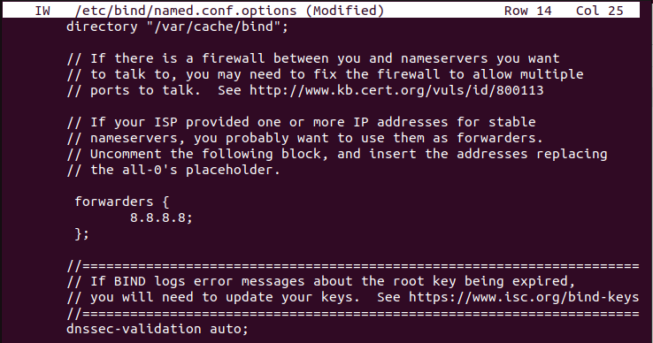
    
6. Iniciar el servicio bind9 y comprobar su estado con los comandos siguientes:
```
service bind9 start
service bind9 status
```

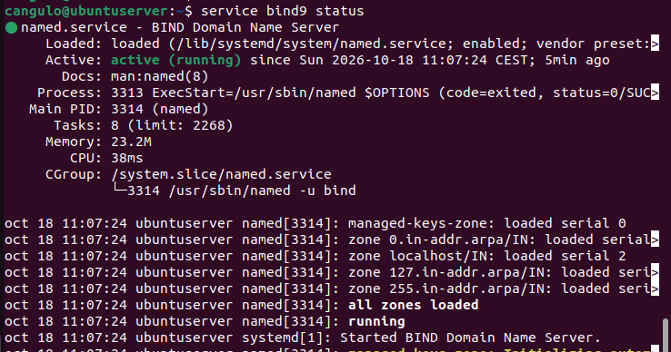

7. Ahora tu servidor tiene que ser capaz de resolver cualquier nombre de dominio conocido por el
servidor 8.8.8.8 de Google ya que le reenviará la consulta. Compruébalo haciendo una consulta:
```
nslookup tipo A a www.youtube.com
```
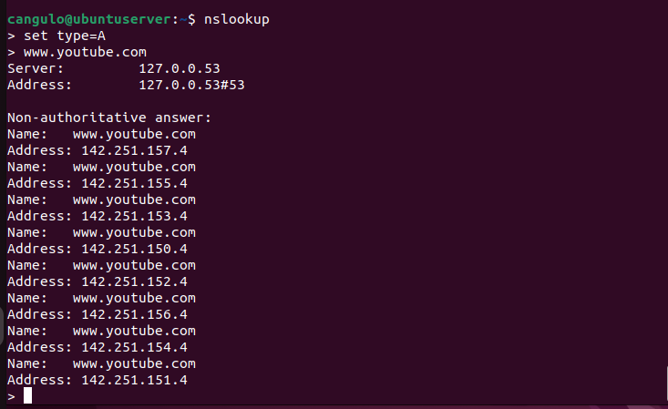


## <div style="background-color: #f5dcd6; color: black; width: 100%; padding: 0px 5px; margin: 0; box-sizing: border-box;">5. Configurar zonas</div> ##

1. Vamos a configurar las zonas sobre las cuales tu servidor bind9 tendrá autoridad. Se trata de los ficheros de resolución directa e inversa:
- una zona directa para la resolución directa (A) → **tunombresmr.local**
- una zona inversa para la resolución inversa (PTR) → **10.168.192.in-addr.arpa**

2. Editar el archivo **/etc/bind/named.conf.local**

3. Añadir los datos de las zonas como a continuación:

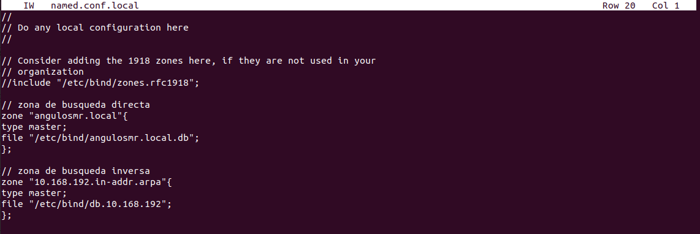

4. Guardar.

5. Comprobar la sintaxis con el comando:
```
named-checkconf /etc/bind/named.conf.local
```


## <div style="background-color: #f5dcd6; color: black; width: 100%; padding: 0px 5px; margin: 0; box-sizing: border-box;">6. Indicar al servidor que solo tome en cuenta los archivos recién configurados</div> ##

1. Editar el archivo **/etc/bind/named.conf**

2. Comentamos la linea que hace referencia a **named.conf.default-zones** para indicar al servidor que no haga caso a este archivo.Guardar.

3. Comprobar la sintaxis con el comando:
```
named-checkconf /etc/bind/named.conf
```

## <div style="background-color: #f5dcd6; color: black; width: 100%; padding: 0px 5px; margin: 0; box-sizing: border-box;">7. Crear los archivos base de datos de las zonas</div> ##

Vamos a crear los 2 archivos que hemos mencionado en el archivo named.conf.local. Para ello haremos copia de los ficheros que ya tenemos en el servidor DNS por defecto.

1. Primero haz una copia del archivo **/etc/bind/db.empty y llámalo tunombresmr.local.db para el servicio de resolución directa:
```
sudo cp db.empty tunombresmr.com.db
```

2. A continuación haz una copia del archivo **/etc/bind/db.empty y llámalo db.10.168.192 para el servicio de resolución inversa:
```
sudo cp db.empty db.10.168.192
```

## <div style="background-color: #f5dcd6; color: black; width: 100%; padding: 0px 5px; margin: 0; box-sizing: border-box;">8. Rellenar los archivos de base de datos de la zona</div> ##

Este paso es muy importante porque vamos a rellenar los dos ficheros, el de resolución directa de zona y el de resolución inversa de zona. Para ello tenemos que configurar adecuadamente la información. Comenzaremos por la resolucón directa y pasaremos después a configurar la inversa.

### <div style="background-color: #cfeef1; color: black; width: 100%; padding: 0px 5px; margin: 0; box-sizing: border-box;">8.1. Archivo db de la zona directa</div> ###

!!! note "Nomenclatura de los parámetros"

    - Para configurar los ficheros correctamente, ten en cuenta las siguientes nomenclaturas:
    - Localiza en el pompt de tu terminal del servidor el nombre de cliente y el nombre de servidor: <span style="color: #1d700c;">cangulo@ubuntuserver</span>

    - En nuestro ejemplo:
    - zona → **angulosmr.local.**
    - nombreservidor → **ubuntuserver**
    - nombrecliente → **cangulo**

1. Edita el archivo **/etc/bind/tunombresmr.com.db** para crear la base de datos de la zona directa

2. Configura la Base de datos tipo SOA:

- Permite configurar el servidor autoritario maestro de la zona
```
zona.       IN          SOA     nombreservidor.zona. root.nombreservidor.zona.
```

!!! note ¿Quien es root?
    root.nombreservidor.zona. es el usuario responsable de la zona

3. Configura la Base de datos tipo NS

- Permite configurar los servidores autoritarios de la zona 
```
zona.       IN          NS      nombreservidor.zona.
```

4. Configura los Registros tipo A para servidor y cliente:

- Permite asociar los nombres de dominio FQDN de los equipos de la zona con sus IPs
```
nombreservidor.zona.    IN      A   192.168.10.5
nombrecliente.zona.     IN      A   192.168.10.140
```

5. A parte del servidor, vamos a suponer que tenemos otros equipos en nuestra zona. Añadir una línea tipo A para cada uno de estos equipos siguiendo el modelo anterior:

- un servidor web **llamado www.zona.** con la **IP: 192.168.10.7**
- un servidor ftp llamado **ftp.zona.** con la **IP 192.168.10.8**
- un servidor para recibir los correos que se llama **mail.zona.** con su **IP 192.168.10.9**
- una impresora llamada **impresora1.zona.** con su **IP 192.168.10.29**

!!! "note Tienes que tener 6 líneas en tu base de datos tipo A"

6. Configura un par de registros tipo CNAME

- Permite asociar un alias a un nombre de dominio que ya se encuentra en la base de datos tipo A. Crear una línea tipo CNAME para que el nombre ns1 apunte a tu servidor 
```
ns1.zona.       IN      CNAME   nombreservidor.zona.
```

- Añadir otra línea tipo CNAME para que el nombre **info.tunombresmr.com.** apunte a la página web **www.tunombresmr.com.**

7. Guardar el archivo

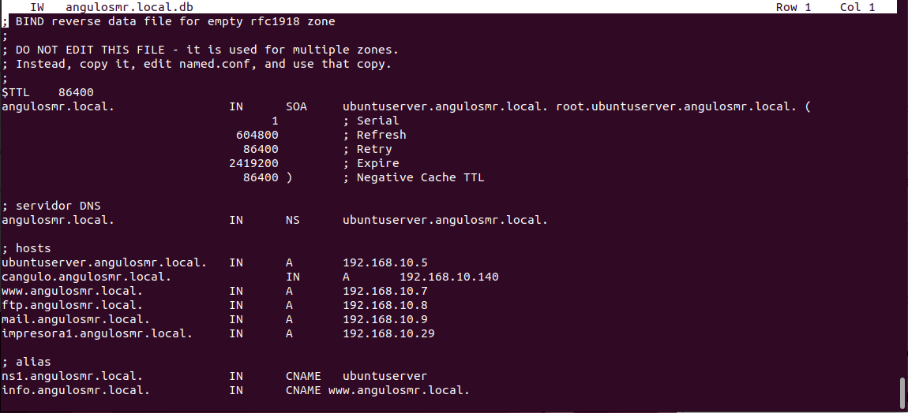

8. Comprobar la sintaxis del fichero con el comando:
```
named-checkzone <nombre zona> /etc/bind/<nombre fichero db de la zona>
```

!!! note "Si está todo correcto tendrás esa respuesta"
    ```
    zone angulosmr.local/IN: loaded serial 1
    OK

!!! warning "¡No olvides el punto!"
    Suele ser muy habitual olviddardse de incluir el punto al final de las direcciones de resolución.
    <span style="color: #e91010;">angulosmr.local → error</span>
    <span style="color: #1d700c;">angulosmr.local. → correcto</span>

### <div style="background-color: #cfeef1; color: black; width: 100%; padding: 0px 5px; margin: 0; box-sizing: border-box;">8.2. Archivo db de la zona inversa</div> ###

1. Editar el archivo **/etc/bind/db.10.168.192** para crear la base de datos de la zona inversa

2. Configura la Base de datos tipo SOA y base de datos tipo NS del mismo modo que para la zona directa pero indicando **@** en el nombre.

3. Configura el registro tipo PTR
- Permite asociar las IPs de los equipos de la zona con sus FQDN. Para las búsquedas inversas.
```
5       IN      PTR     nombreservidor.zona.
```

4. Para cada línea tipo A del archivo tunombresmr.com.db tienes que tener una línea tipo PTR en el archivo **db.10.168.192**. 

5. Cambia el puerto serial del archivo, de modo que no sea el mismo que el del archivo de la zona directa. Puedes usar por ejemplo el puerto seria 2 para la zona inversa.

6. Guarda el archivo.

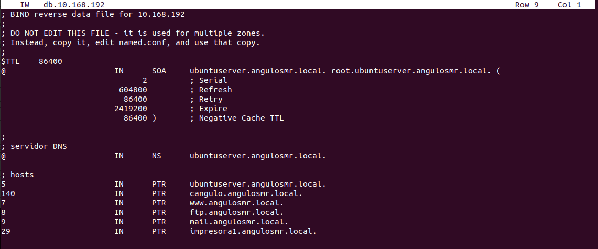

7. Comprueba la sintaxis del fichero con el comando:
```
named-checkzone <nombre zona> /etc/bind/<nombre fichero db de la zona>
```

!!! note "Resultado si ha tenido éxito"
    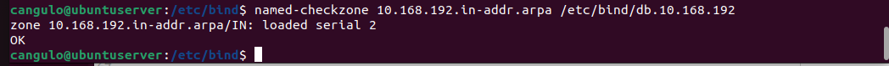


## <div style="background-color: #f5dcd6; color: black; width: 100%; padding: 0px 5px; margin: 0; box-sizing: border-box;">9. Reiniciar el servicio y comprobar el estado</div> ##

1. Una vez comprobado que NO existen errores de sintaxis, reiniciar el servicio y comprobar su estado:
```
service bind9 restart
service bind9 status
```

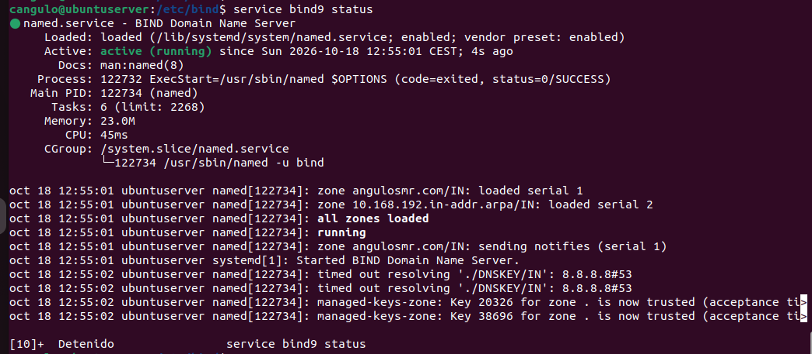

!!! warning "Servidor Ubuntu a la red NAT"
    Si todavía no lo has hecho, vuelve a incluir tu servidor Ubuntu en la Red NAT

## <div style="background-color: #f5dcd6; color: black; width: 100%; padding: 0px 5px; margin: 0; box-sizing: border-box;">10. Indicar al cliente Ubuntu quien es el servidor DNS</div> ##

1. En el cliente deberás configurar estáticamente:

    - IP del cliente Ubuntu: **192.168.10.140** e
    - IP del servidor DNS: **192.168.10.5**
    - En el archivo /etc/resolv.conf indicamos que el servidor de nombres nameserver es **192.168.10.5**

!!! note "¿Recuerdas cómo?"
    En la Actividad02, en el punto 5.1. se indica cómo configurar estáticamente la IP, DNS y demás a un cliente Ubuntu.    

2. Comprueba si ha funcionado ejecutando en la consola el comando nslookup y, a continuación, server. Nos tiene que indicar que el servidor DNS del cliente es 192.168.10.5

## <div style="background-color: #f5dcd6; color: black; width: 100%; padding: 0px 5px; margin: 0; box-sizing: border-box;">11. Comprobación final</div> ##

1. Desde el cliente, realiza consultas **nslookup** a tu servidor DNS para ver si resuelve:

<span style="color: #8710e9;">a)</span> Petición nslookup al registro tipo A para todos los dispositivos de la zona
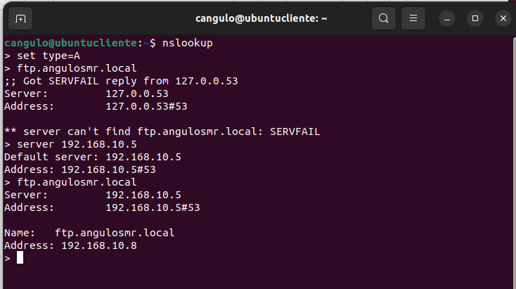

<span style="color: #8710e9;">b)</span> Petición nslookup al registro tipo SOA. 
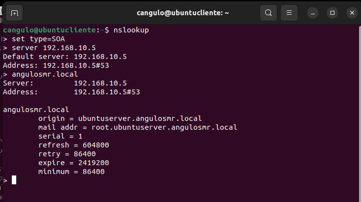

<span style="color: #8710e9;">c)</span> Petición nslookup al registro tipo NS.

<span style="color: #8710e9;">d)</span> Petición nslookup al registro tipo CNAME para los 2 alias de la zona

<span style="color: #8710e9;">e)</span> Petición nslookup a un nombre de dominio de internet que puedes elegir

<span style="color: #8710e9;">f)</span> Petición nslookup de resolución inversa
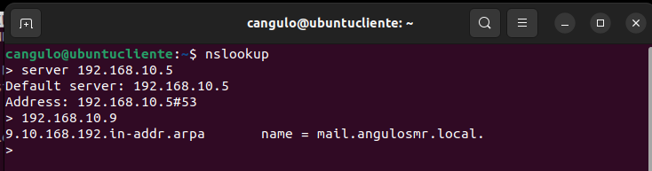


!!! success "ACtividad final"
    - Realiza la misma actividad pero para un dominio **.com**. 
    - Recuerda que la tarea consiste en buscar todos los puntos en los que has creado una configuración **.local**
    - No elimines ningún fichero, simplemente realiza una copia del mismo. Realiza capturas de los mismos.


