# Actividad 08. Servidor DNS en Windows

## 
Objetivo de la actividad
 ##

Crear un servidor DNS que sea capaz de resolver zonas directa e indirectamente. 

!!! success "Trabajo a entregar"
    - Un tutorial de creación y configuración del servidor DNS en Windows que cubra todas las etapas 
    - Recuerda incluir también capturas correspondientes.

## 
1. Configuración previa
 ##

1. Abre el servidor UbuWindows y configura su tarjeta de red del siguiente modo:

- Abre el Administrador del Servidor (Server Manager).
- En el menú izquierdo haz clic en Servidor Local.
- Busca la línea donde dice Ethernet y haz clic sobre el enlace azul.
- En la ventana de conexiones, haz clic derecho sobre el adaptador Ethernet y selecciona
Propiedades.
- Haz doble clic sobre Protocolo de internet versión 4 (TCP/IPv4).
- Selecciona "Usar la siguiente dirección IP"
- Introduce la IP del Servidor Windows 2019: **192.168.10.6**
- IP servidor DNS: **192.168.10.6**
- IP servidor DNS secundario: **8.8.8.8**

## 
2. Instalación del rol DNS
 ##

1.- Vamos a instalar el servicio DNS que en Windows Server 2019 es tratado como un rol de trabajo. Para ello seguir los pasos:
`Panel ➔ Administrar ➔ Agregar roles y características`

2.- Dejar valores por defecto en `Antes de comenzar -> Tipo de instalación`

3.- En `Selección de servidor` elejir el servidor actual. 

4.- En roles de servidor hacer clic en `Servidor DNS`

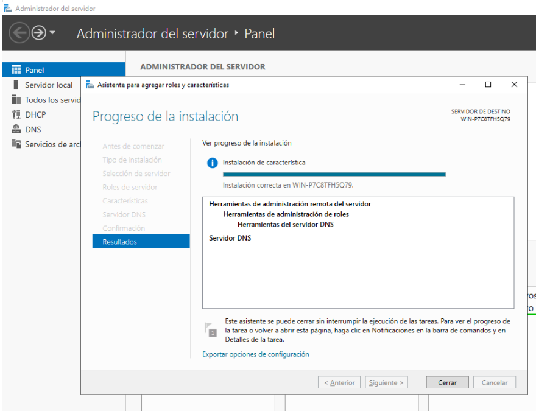

5.- Agregar características y seguir los pasos hasta terminar la instalación.

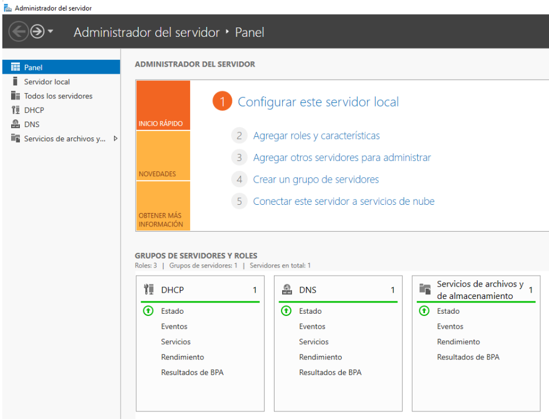

## 
3. Creación de una zona de búsqueda directa
 ##

Como ya hicimos en el servidor DNS de Ubuntu, ahora vamos a configurar la zona directa en el servidor DNS de Windows. Para ello seguir los siguientes pasos:

1.- En el Administrador de Servicios, nos vamos a Herramientas y hacemos clic en DNS.

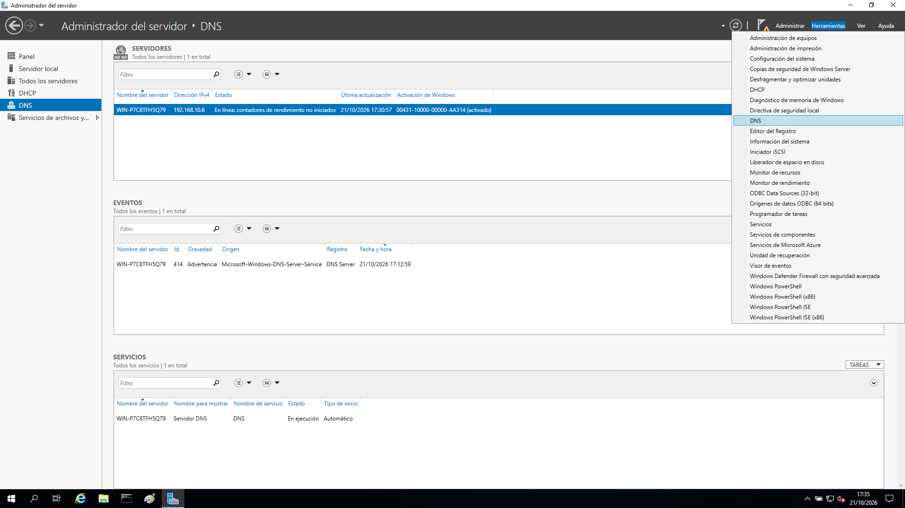

2.- Hacemos doble clic en DNS.

3.- Hacemos clic con el botón derecho sobre `zonas de búsqueda directa`

4.- Clic en `zona nueva`.

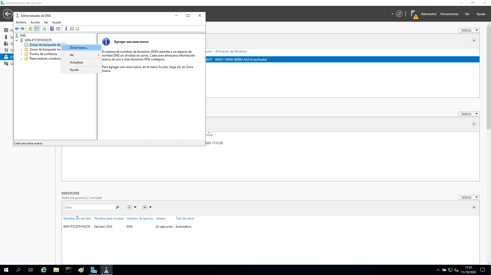

5.- A continuación aparecerá el **Asistente para la nueva zona** y debemos seguir los siguientes pasos indicando la siguiente  información:

- Elegir **zona principal**
- Indicar como nombre de zona: **nombre_alumno.local**
- Crear archivo con nombre: **nombre_alumno.local.dns**
- No admitir actualizaciones dinámicas.

El resultado final será disponer de una zona DNS de resolución directa llamada **nombre_alumno.local.dns**

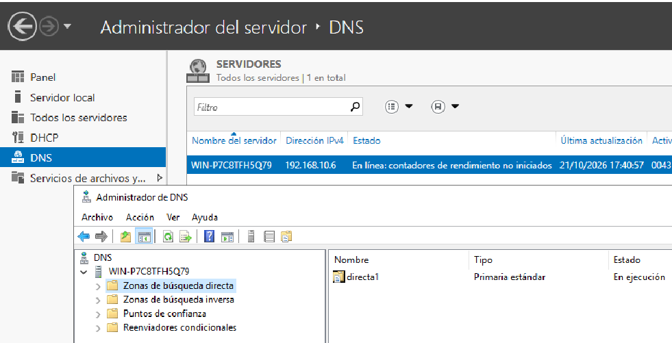
 

## 
4. Creación de una zona de búsqueda inversa
 ##

El modo de creación será muy similar al utilizado para crear una zona DNS de resolución directa

1.- En el Administrador de Servicios, nos vamos a Herramientas y hacemos clic en DNS.

2.- Hacemos doble clic en DNS.

3.- Hacemos clic con el botón derecho sobre `zonas de búsqueda inversa`

4.- Clic en `zona nueva`.

5.- A continuación aparecerá el **Asistente para la nueva zona** y debemos seguir los siguientes pasos indicando la siguiente  información:

- Elegir **zona principal**
- Indicar como nombre de zona de búsqueda inversa: **zona de búsqueda inversa para IPv4**
- Crear archivo con nombre: **192.168.10**
- Indicar el archivo con nombre: **10.168.192.in-addr.arpa.dns**
- No admitir actualizaciones dinámicas.

El resultado final será disponer de una zona DNS de resolución directa llamada **10.168.192.in-addr.arpa**

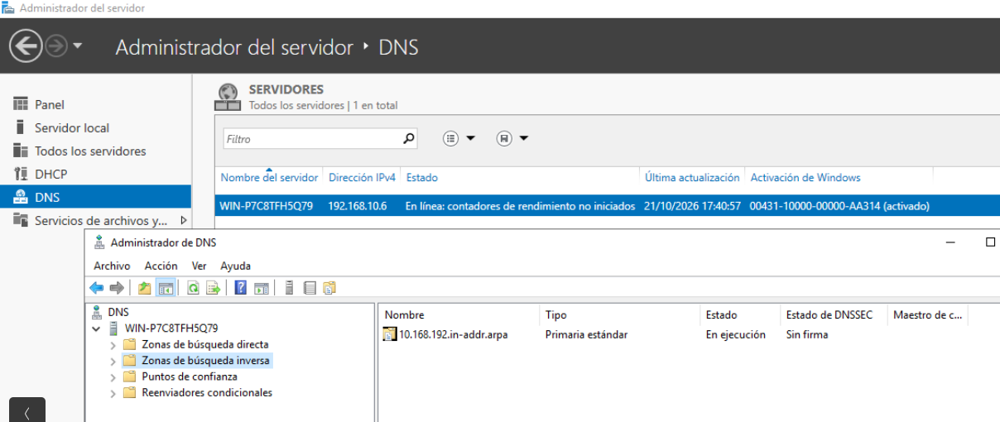

## 
5. Configuración de la zona de búsqueda directa
 ##

Ahora vamos a configurar la zona de resolución directa asignando los mismos datos que trabajamos con el servidor DNS Ubuntu. 

!!! note "Para empezar deberás tener claras estos tres conceptos"

    - zona → `tunombrewin.local`
    - nombre del servidor → `winserver`
    - nombre de tu cliente → `tunombre`

### Zona tipo SOA ###

1.- Vamos a configurar la zona **Tipo SOA**. Para ello hacer clic con el botón derecho sobre `(inicio de autoridad SOA)` y abrirmos sus `propiedades`.

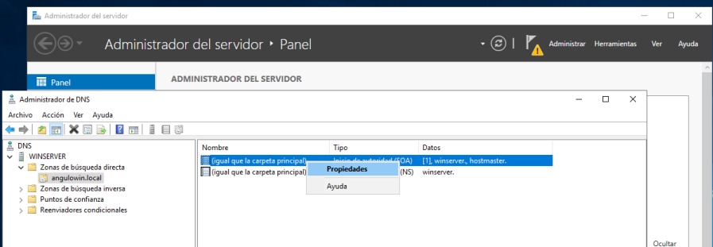

2.- Asginamos la información relativa a nuestro servidor: `nombreservidor.zona`

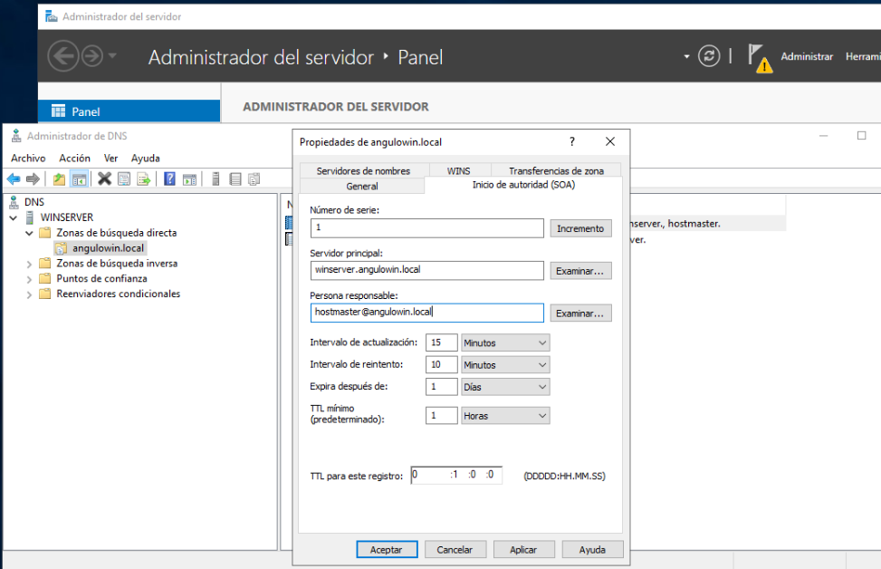

### Zona tipo NS ###

1.- Para configurar la zona **Tipo NS** hay que hacer clic con el botón derecho sobre `(Servidor de nombres DNS)` y abrirmos sus `propiedades`.

2.- A continuación configuraremos el formulario con la siguiente información:

- del servidor DNS: `nombreservidor.zona`d
- de la persona responsable: `dejar valor por defecto`

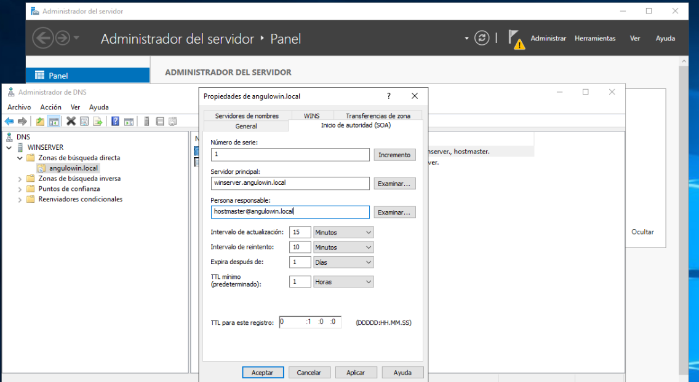

### Zona tipo A ###

1.- Pulsar con el botón derecho del ratón en la zona creada y elegir **Host nuevo (A o AAAA)** para configurar lecturas **TIPO A**

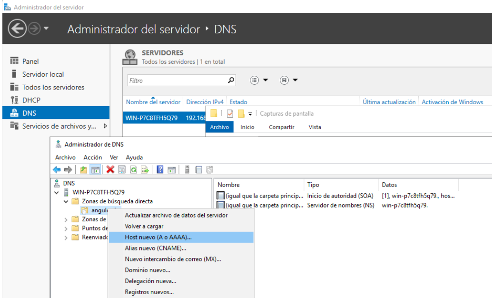

2.- En el formulario que os aparece indicar nombre FDQN completo y la IP correspondiente. Por ejemplo para la opción `www.angulowin.local`:

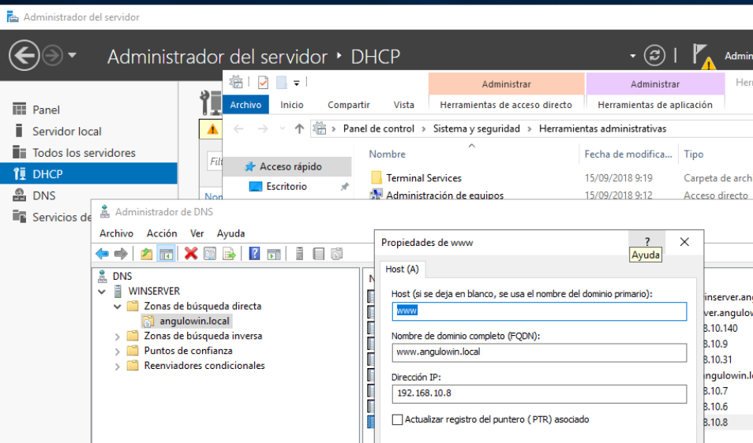

3.- Completa todas las entradas con la información que se muestra en la siguiente tabla:

| Nombre FQDN | IP             |
| ------------|----------------|
| www         | 192.168.10.8   | 
| ftp         | 192.168.10.9   |
| impresora1  | 192.168.10.31  |
| mail        | 192.168.10.7   |
| cangulo     | 192.168.10.140 |
| winserver   | 192.168.10.6   |

### Zona tipo CNAME ###
 
1.- A continuación vamos a completar la información relativa a los alias. Para ello pulsamos con el botón derecho sobre nuestra zona y elegimos la opciṕon CNAME.

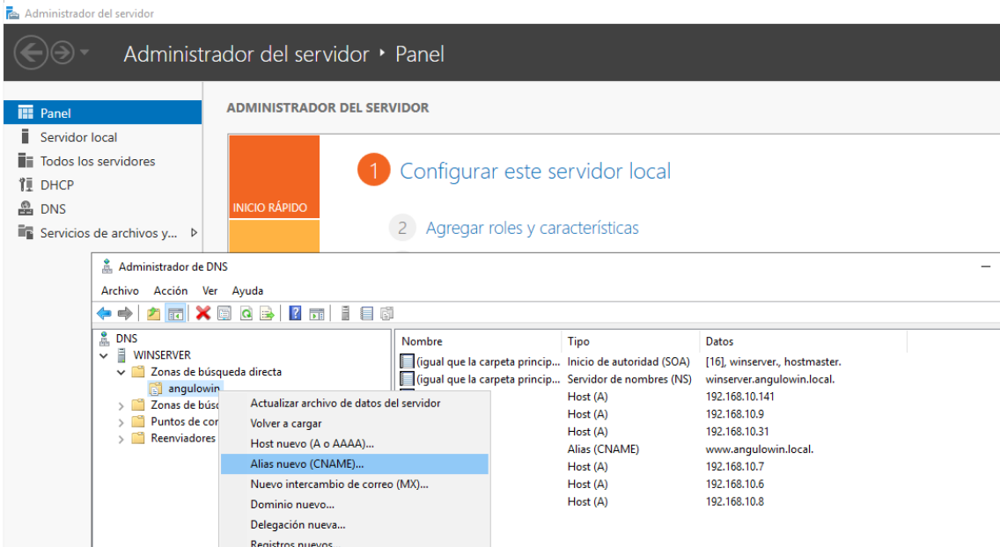

2.- Rellenamos el formulario con el alias del siguiente modo: 

- Nombre del alias: **info**
- Nombre del dominio completo: `www.zona`

!!! warning "Recuerda tu zona"
    Recuerda que tu zona debería ser algo parecido a **tunombrewin.local**. Por ejemplo cangulowin.local

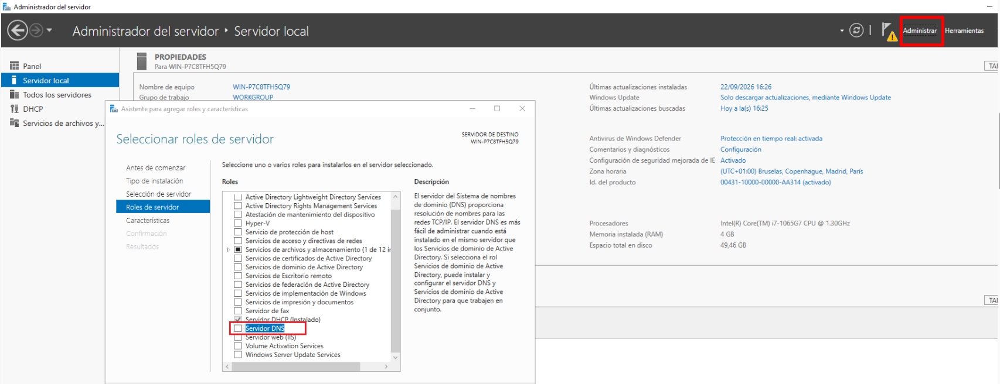

!!! note "Resultado final zona directa"
    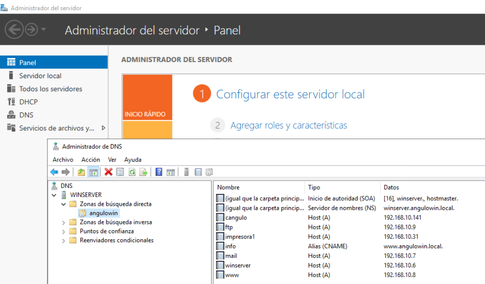

## 
6. Configuración de la zona de búsqueda inversa
 ##

La configuración de la zona inversa se hará de modo muy similar la zona directa:

1.- La zona SOA y NS se configura igual que la zona directa.

### Zona tipo PTR ###

1.- Para configurar los PTR haremos clic en la zona inversa y elegimos la opción (PTR)

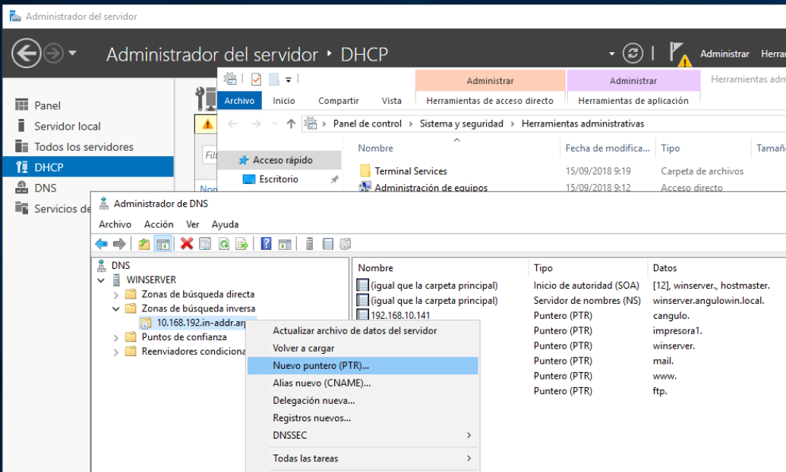

2.- Rellenar el formulario indicando las IP y la zona directa de cada elemento visto anteriormente

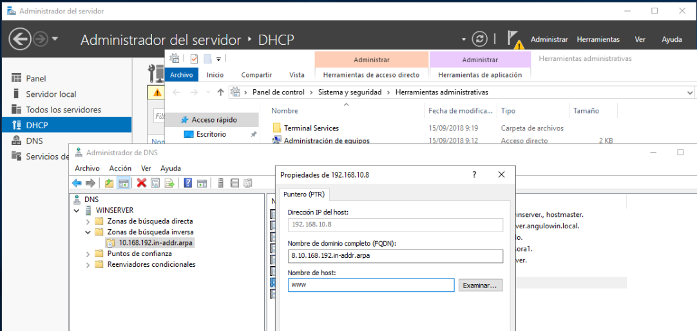

!!! note "Resultado final zona inversa"
    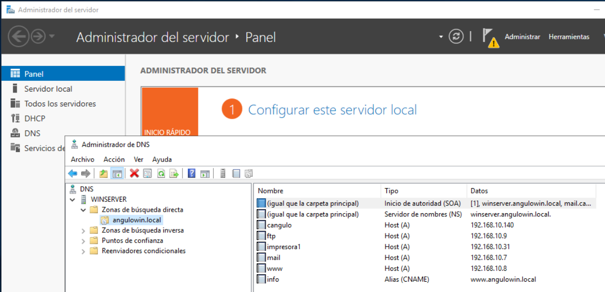
