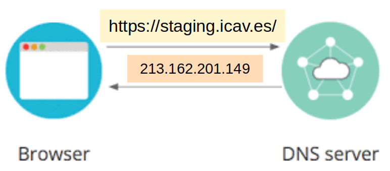
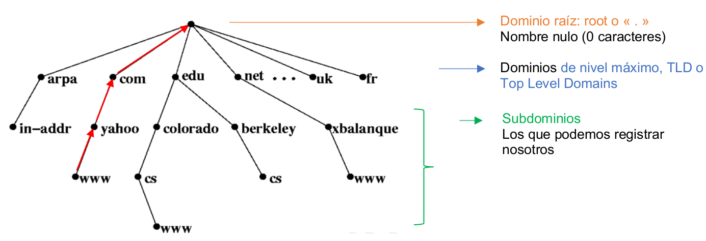
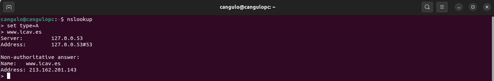
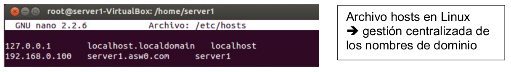
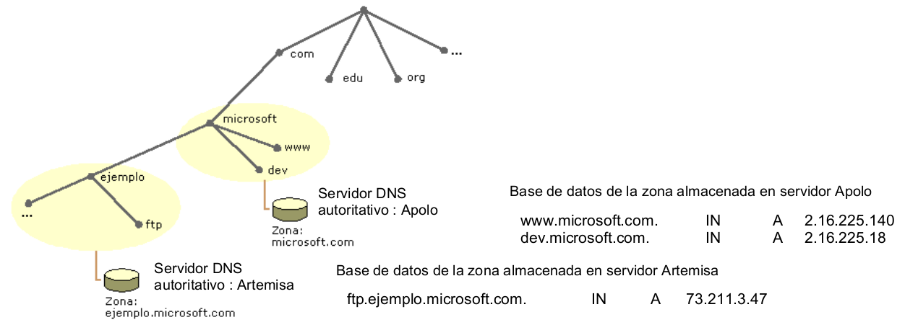
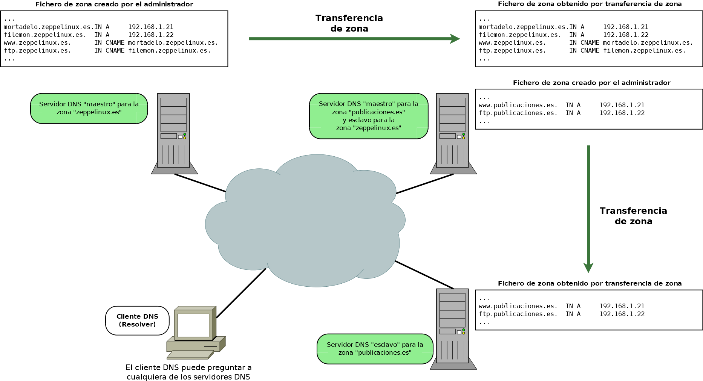
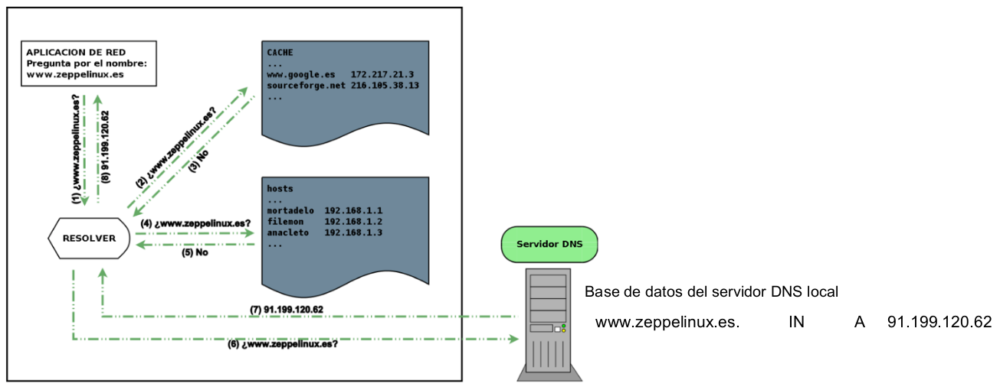
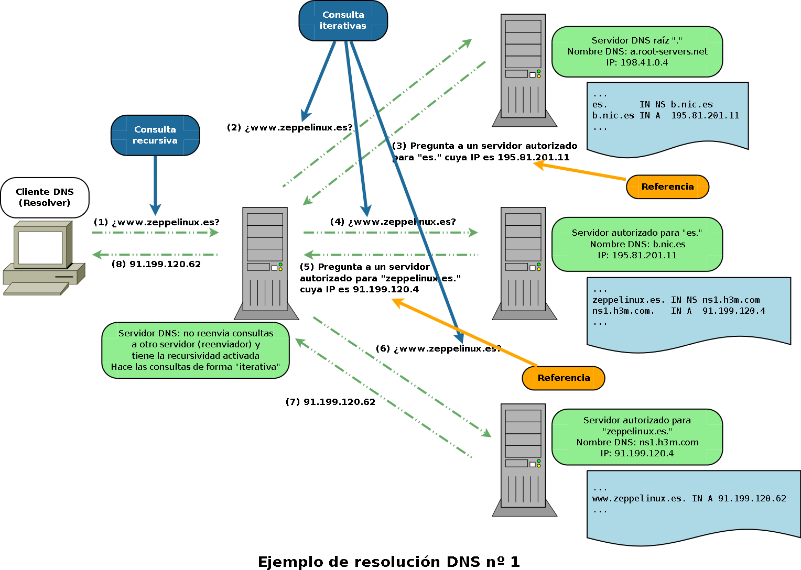

## <div style="background-color: #ff5733; color: black; width: 100%; padding: 0px 5px; margin: 0; box-sizing: border-box;">1. El servicio DNS</div> ##


El servicio DNS (Domain Name System) o Sistema de Nombres de Dominio sirve para asociar nombres de dominio a direcciones IP.




!!! success Realiza la siguiente prueba
    Introduce la IP **213.162.201.149** en el navegador y verás que te lleva a la página web del Valencia Basket. No obstante, para llegar a esta página web, solemos teclear su nombre de dominio **https://staging.icav.es/**

En una red TCP/IP las máquinas se identifican mediante su dirección IP. Sin embargo, para las personas resulta mucho más sencillo recordar el nombre que se asocia a una máquina concreta.

Conocer el nombre de un servicio en lugar de la IP de la máquina también es más fiable porque:
- Un servicio (por ejemplo, la página www.valenciabasket.com) puede cambiar de máquina, y entonces de IP, pero no de nombre.
- Puede haber varios servicios alojados en una única máquina.

Esto hace necesario establecer un mecanismo de traducción de nombres de dominio a direcciones IP. El DNS es el servicio que proporciona este mecanismo de traducción.

## <div style="background-color: #ff5733; color: black; width: 100%; padding: 0px 5px; margin: 0; box-sizing: border-box;">2. Nombres de Dominio</div> ##


Un nombre de dominio o dominio es un texto que nos permite identificar un servicio en la red, como una página web, un servidor FTP, un servidor de correo. El dominio tiene que ser único en la red.

Los nombres de dominio siguen una estructura jerárquica en forma de árbol:



### Dentro de los dominios de máximo nivel TLD existen: ###

- dominios genéricos: **arpa, com, edu, net…**
- dominios de país: **fr, .es,.uk,.mx...**

!!! note "¿Cómo leer un nombre de dominio?"
    - El nombre de dominio absoluto o FQDN (Fully Qualified Domain Name) se obtiene empezando por el subdominio de nivel más bajo hasta  llegar al dominio raíz.
    - Ejemplo de FQDN www.yahoo.com.

La estructura en árbol del espacio de nombres de dominio proporciona un mecanismo de identificación única de un dominio. No puede existir ningún otro dominio que tenga exactamente el mismo nombre absoluto o FQDN.

### Información adicional: ###

El dominio raíz (.) y los dominios TLD genéricos son gestionados por la **ICANN** (Internet Corporation for Assigned Names and Numbers) Corporación de Internet para la Asignación de Nombres y Números. La ICANN es también es responsable de asignar las direcciones IP.
Los dominios de país son registrados por las autoridades locales. En el caso de España la autoridad competente es Red.es.

## <div style="background-color: #ff5733; color: black; width: 100%; padding: 0px 5px; margin: 0; box-sizing: border-box;">3. Consultas DNS</div> ##

Las consultas **nslookup** o dig nos permiten obtener información sobre nombres de dominio. Son peticiones que se realizan utilizando una herramienta de consola por línea de comandos diseñada para averiguar la correspondencia entre nombres de dominio y direcciones IP.

!!! success "Ejemplo"
    ¿A qué IP apunta el nombre de dominio www.icav.es
    

!!! note "El parámetro type"
    El parámetro type en nslookup sirve para indicarle al servidor DNS qué tipo específico de registro o recurso estás buscando dentro de un dominio.

| Tipo   | Descripción                                                                     |
| ------ | ------------------------------------------------------------------------------- |
| A      | Devuelve la dirección IPv4 asociada a un nombre de dominio                      |
| AAAA   | Devuelve la dirección IPv6 asociada a un nombre de dominio                      |
| CNAME  | Devuelve una lista de alias, si existen, para el nombre verdadero (canonical)   |
| NS     | Devuelve información sobre los servidores DNS autoritativos de la zona          |
| SOA    | Devuelve información sobre el servidor DNS autoritativo maestro de la zona      |
| PTR    | Devuelve el nombre de dominio asociado a una IP (inversa de A)                  |
| MX     | Devuelve el servidor encargado de recibir el correo electrónico para el dominio |


## <div style="background-color: #ff5733; color: black; width: 100%; padding: 0px 5px; margin: 0; box-sizing: border-box;">4. Origen y normativa</div> ##


En los años 70, existía un único archivo llamado hosts que indicaba la correspondencia nombre/IP de todas las máquinas de ARPANET, el predecesor de internet. Cada máquina obtenía una copia actualizada del archivo periódicamente vía FTP.



Pero, con el crecimiento de ARPANET, esta gestión centralizada se hizo inmanejable. Al principio de los años 80 surgió DNS para aportar una solución compatible con una red en constante crecimiento y evolución. Las primeras RFC que describieron el servicio DNS fueron publicadas en 1984. Actualmente los estándares vigentes para DNS son:

- Las RFC 1034 y 1035 que describen el servicio DNS IPv4
- La RFC 1886 que tratan de extensiones para admitir la versión 6 del protocolo IP

## <div style="background-color: #ff5733; color: black; width: 100%; padding: 0px 5px; margin: 0; box-sizing: border-box;">5. Arquitectura cliente servidor</div> ##

El servicio DNS se basa en una arquitectura cliente-servidor:

- Servidor DNS: es un equipo que ofrece el servicio DNS, es decir que atiende las peticiones de los clientes traduciendo un nombre de dominio en IP.
- Cliente DNS: es un equipo de la red que solicita la traducción de un nombre de dominio a IP a un servidor DNS. La parte del cliente que se encarga de hacer la petición al servidor y de enviar la respuesta a la aplicación que lo necesita.

!!! note "Por ejemplo"
    El navegador web, en el caso de querer consultar una página web. A este efecto se le llama **resolver un nombre de dominio**

## <div style="background-color: #ff5733; color: black; width: 100%; padding: 0px 5px; margin: 0; box-sizing: border-box;">6. Servidor DNS autoritativo, zona y base de datos de la zona</div> ##

**Zona:** es una parte del espacio de nombres de dominio gestionada por un (o más) servidores DNS.
Los servidores que gestionan la zona se saben todas las relaciones entre nombres de dominio e IPs de la zona gracias a su base de datos (registros). Se dice que tienen autoridad respecto a la zona. En este caso, también hablamos de servidor DNS autoritativo de la zona.

**Base de datos de zona:** son los archivos que almacenan la correspondencia nombres de dominio --> IP de los equipos que pertenecen a la zona.



El diagrama ilustra cómo se divide el espacio de nombres jerárquico de DNS en distintas zonas de autoridad administradas por servidores DNS autoritativos específicos.
A continuación, se detalla la explicación de cada uno de los conceptos reflejados en la imagen:

##### <span style="color: #ff5733;">1. El Espacio de Nombres Jerárquico (Árbol DNS) #####

En la parte superior izquierda se observa la estructura de árbol invertido del DNS:

- El nodo raíz (arriba del todo) se divide en dominios de nivel superior o TLD (como .com, .edu, .org).
- Del dominio **.com** cuelga el subdominio microsoft.
- Del dominio microsoft.com cuelgan otros subdominios como **www, dev** y un subdominio completo llamado ejemplo.

##### <span style="color: #ff5733;">2. Concepto de Zona DNS #####

Una zona es una parte del árbol DNS que se administra de forma conjunta y delegada. El diagrama muestra que un dominio puede dividirse en varias zonas independientes (representadas por los óvalos amarillos):

- **Zona microsoft.com:** Contiene los registros del dominio principal y de subdominios inmediatos como www y dev. Sin embargo, decide delegar la administración de una de sus ramas, llamada ejemplo, a otra entidad.
- **Zona ejemplo.microsoft.com:** Al ser delegada, se convierte en una zona completamente independiente con su propio archivo de configuración, que gestiona el host ftp y subdominios inferiores.

##### <span style="color: #ff5733;">3. Servidores DNS Autoritativos #####

Cada zona está bajo la responsabilidad de un servidor físico que posee la base de datos oficial (no una copia en caché) de esos nombres:

- **Servidor Apolo:** Es el servidor DNS autoritativo para la zona microsoft.com.
-  **Servidor Artemisa:** Es el servidor DNS autoritativo para la zona ejemplo.microsoft.com.

##### <span style="color: #ff5733;">4. Base de Datos de la Zona (Registros de Recurso) #####

A la derecha se muestran los archivos de zona o bases de datos con registros reales de tipo A (mapeo de nombre a dirección IPv4):

- En el servidor Apolo (Zona microsoft.com):

	- **www.microsoft.com.** apunta a la IP 2.1.16.225.140.
	- **dev.microsoft.com.** apunta a la IP 2.16.225.18.
Nota que el subdominio "ejemplo" no aparece aquí porque su autoridad fue delegada al otro servidor.

- En el servidor Artemisa (Zona ejemplo.microsoft.com):
	- **ftp.ejemplo.microsoft.com.** apunta a la IP 73.211.3.47.


## <div style="background-color: #ff5733; color: black; width: 100%; padding: 0px 5px; margin: 0; box-sizing: border-box;">7. Tipos de servidores DNS y transferencia de zona</div> ##

## Tipos de servidores DNS y transferencia de zona ##

El estándar DNS establece que hay que configurar al menos dos servidores autoritativos para cada zona: 

- **Servidor primario (o maestro):** Tiene la base de datos de la zona en versión modificable. Todas las modificaciones sobre una zona, como añadir nombres de dominios, se llevan a cabo en el servidor primario.
- **Servidor secundario (esclavo):** contiene una copia de solo lectura de la base de datos de la zona. Así, si el servidor primario falla, el segundo atiende las peticiones de resolución de nombres.
- **Servidor caché:** normalmente colocado entre los clientes y los servidores de nombres autoritativos, recibe las respuestas de las consultas DNS de los clientes y las guarda en su caché durante un tiempo (TTL) para responder más rápido a las mismas preguntas si surgen de nuevo.    

### Transferencia de zona ###

El servidor secundario mantiene el archivo de base de datos de la zona actualizado mediante un mecanismo denominado transferencia de zona. A continuación veremos un ejemplo de este funcionamiento:



Este diagrama ilustra el funcionamiento de la arquitectura **Maestro/Esclavo** en servidores DNS y el proceso de Transferencia de Zona, un mecanismo fundamental para garantizar la redundancia, la tolerancia a fallos y el equilibrio de carga en una infraestructura de red. A continuación, se detalla la explicación analizando los elementos clave del esquema:

##### <span style="color: #ff5733;">1. Roles de los Servidores DNS (Maestro y Esclavo) #####

El diagrama muestra que un mismo servidor físico puede tener diferentes roles dependiendo de la zona DNS que gestione:

- **Servidor DNS Maestro o Primario:** Es el servidor donde el administrador de red crea y modifica directamente los ficheros  de zona a mano. En el diagrama vemos dos zonas maestras diferenciadas:
	
    - El servidor de la izquierda es el maestro único para la zona **zeppelinux.es**.
	- El servidor del centro actúa como maestro para una zona distinta llamada **publicaciones.es**.

- **Servidor DNS Esclavo o Secundario:** Es un servidor de respaldo que contiene una copia idéntica de la zona de un maestro. No permite la edición manual de los registros; en su lugar, los obtiene automáticamente del maestro. El diagrama nos muestra dos casos de esclavos:

	- El servidor central, además de ser maestro de su propia zona, actúa como esclavo para la zona **zeppelinux.es**.
	- El servidor de la derecha actúa como esclavo para la zona **publicaciones.es**.

##### <span style="color: #ff5733;">2. El Proceso de Transferencia de Zona #####

Las flechas verdes gruesas representan la Transferencia de zona (Zone Transfer). Es el protocolo mediante el cual un servidor esclavo se conecta a su servidor maestro correspondiente para descargar una copia exacta del fichero de configuración de la zona.

- **Transferencia de zeppelinux.es**: El servidor central (esclavo) solicita y copia el fichero desde el servidor de la izquierda (maestro).
- **Transferencia de publicaciones.es**: El servidor de la derecha (esclavo) solicita y copia el fichero desde el servidor central (maestro).

##### <span style="color: #ff5733;">3. Ficheros de Zona e Interpretación de Registros #####

En los recuadros de texto se aprecian los registros de recursos (RR) que se replican textualmente de un servidor a otro:

- Registros Tipo A (Dirección IPv4): Asocian un nombre de host a una IP real.
	- **mortadelo.zeppelinux.es** → 192.168.1.21
	- **filemon.zeppelinux.es** → 192.168.1.22
- Registros Tipo CNAME (Alias): Crean un sobrenombre que apunta a un registro A ya existente.
	- **www.zeppelinux.es** → alias de mortadelo.zeppelinux.es.
	- **ftp.zeppelinux.es** → alias de filemon.zeppelinux.es.

#### <span style="color: #ff5733;">4. El Cliente DNS (Resolver) ####

En la esquina inferior izquierda se sitúa el Cliente DNS (instancia de resolución del sistema operativo) conectado a la red (nube).

- El esquema destaca que el cliente puede preguntar a cualquiera de los tres servidores DNS. Al estar todos sincronizados gracias a las transferencias de zona, cualquiera de ellos le devolverá exactamente la misma respuesta de resolución de nombres, logrando que si un servidor se cae, la red siga funcionando con normalidad.

## <div style="background-color: #ff5733; color: black; width: 100%; padding: 0px 5px; margin: 0; box-sizing: border-box;">8. Bases de datos del servidor DNS</div> ##

Las bases de datos de un servidor DNS son los conjuntos de archivos estructurados, comúnmente llamados ficheros de zona, donde se almacena toda la información técnica necesaria para mapear nombres de dominio legibles por humanos a sus correspondientes direcciones IP de la máquina, así como otros recursos de la red.

El servicio DNS utiliza bases de datos de texto plano estructuradas formadas por líneas individuales conocidas como Registros de Recurso (RR).

!!! note "Ejemplo de base de datos db.iespuzol.es"
    Si en el servidor DNS de un centro educativo se crea una base de datos para la zona local, el archivo de configuración de texto plano se vería exactamente así:
```
$TTL 1D
@   IN  SOA  ns1.iespuzol.es. admin.iespuzol.es. (
             2026101701 ; Número de serie (Fecha del día + revisión)
             1D         ; Tiempo de refresco para servidores esclavos
             1H         ; Tiempo de reintento si falla el maestro
             1W         ; Tiempo de expiración de la copia
             3H )       ; Caché negativa mínima

; Servidores DNS Autorizados para esta base de datos
    IN  NS   ns1.iespuzol.es.
    IN  NS   ns2.iespuzol.es.

; Servidor de Correo de la escuela
    IN  MX 10 mail.iespuzol.es.

; Mapeos de nombres de Host a IP (Registros A)
ns1     IN  A    192.168.1.10
ns2     IN  A    192.168.1.11
mail    IN  A    192.168.1.20
server1 IN  A    192.168.1.50

; Alias o Sobrenombres (Registros CNAME)
www     IN  CNAME server1.iespuzol.es.
aula3   IN  CNAME server1.iespuzol.es.
```

## <div style="background-color: #ff5733; color: black; width: 100%; padding: 0px 5px; margin: 0; box-sizing: border-box;">9. Funcionamiento de la resolución de nombres de dominio</div> ##

La resolución de nombres de dominio es el proceso técnico mediante el cual se traduce un nombre de dominio comprensible para los humanos **como google.com**, en una dirección IP binaria o numérica **como 142.250.200.46** que las máquinas y los routers pueden entender para comunicarse entre sí. Dado que para las personas es mucho más fácil recordar palabras que largas cadenas de números, este mecanismo actúa como la **agenda de contactos** de Internet.

Veremos tres modos de funcionamiento de la resolución de nombres de dominio:

- Funcionamiento general.
- Resolución directa.
- Resolución inversa.

### Funcionamiento general ###

El servicio DNS utiliza el protocolo DNS para hacer las consultas y las respuestas. Se trata de un protocolo de la capa de aplicación que puede utilizar tanto TCP como UDP en la capa de transporte.

Servidor y cliente se comunican mediante de puerto 53.

### Resolución directa ###

Cuando una aplicación como por ejemplo en navegador web necesita resolver un dominio, la aplicación invoca el **cliente** o la operación  **resolver** para que realice las consultas necesarias y obtenga la respuesta. Luego, el resolver se encarga de pasar la respuesta a la aplicación que lo necesita, en este caso el navegador.

Antes que nada, el resolver investiga el archivo hosts y la caché. Si no encuentra nada en local, el resolver pregunta al servidor DNS local que tiene configurado.

En la resolución de nombres, hay 2 tipos de consultas posibles:

- Recursiva: el servidor DNS da una respuesta completa. El cliente consulta a su servidor DNS local de manera recursiva.
- Iterativa: el servidor DNS da una respuesta parcial, por ejemplo, una lista de IP de servidores DNS a los que preguntar para seguir avanzando. Usualmente los servidores se consultan entre ellos de manera iterativa.

#### <div style="background-color: #eeebcf; color: black; width: 100%; padding: 5px 10px; margin: 0; box-sizing: border-box;">Caso 1. Resolución directa</div> ####

El servidor DNS encuentra la IP del dominio buscado en su base de datos porque se trata de un dominio de la zona que gestiona. La respuesta será autoritativa.



Este diagrama detalla de forma secuencial los pasos que sigue el sistema de resolución local de un sistema operativo para resolver un nombre de dominio, mostrando el orden de prioridad estricto antes de salir a Internet. A continuación se describe el proceso paso a paso:

##### <span style="color: #ff5733;">1. La Petición Inicial de la Aplicación #####

- En el extremo superior izquierdo, una aplicación de red como un navegador web solicita acceder a un sitio web.
- Envía la pregunta (1) **¿www.zeppelinux.es?** al componente interno del sistema operativo encargado de buscar la IP: el **Resolver**.

##### <span style="color: #ff5733;">2. Paso 1 en el Orden de Prioridad: La Memoria Caché Local #####

- El Resolver no sale inmediatamente a la red. Lo primero que hace es consultar la Memoria Caché DNS interna de la propia máquina.
- Envía la consulta (2) ¿www.zeppelinux.es? a la caché.
- Como se observa en la lista (www.google.es, sourceforge.net), el dominio buscado no está almacenado temporalmente ahí, por lo que la caché responde con un (3) No.

##### <span style="color: #ff5733;">3. Paso 2 en el Orden de Prioridad: El Archivo local hosts #####

- Al no encontrarlo en la caché, el Resolver recurre al archivo estático local del sistema operativo conocido como fichero hosts.
- Envía la consulta (4) ¿www.zeppelinux.es? a este archivo de texto plano.
- La base de datos del archivo contiene únicamente registros locales (mortadelo, filemon, anacleto), de modo que tampoco tiene constancia de esa dirección web y devuelve un (5) No.

##### <span style="color: #ff5733;">4. Paso 3 en el Orden de Prioridad: El Servidor DNS Externo #####

- Habiendo agotado las opciones locales de almacenamiento del propio equipo (Caché = No, Hosts = No), el Resolver se ve obligado a enviar la petición fuera de la máquina, hacia la red.
- Lanza la consulta (6) ¿www.zeppelinux.es? al Servidor DNS local configurado en la tarjeta de red (el de la escuela o proveedor de Internet).
- El Servidor DNS abre su propia base de datos, localiza el registro de recurso de tipo A (www.zeppelinux.es. IN A 91.199.120.62) y responde de vuelta con la dirección IPv4 pública correspondiente (7) 91.199.120.62.

##### <span style="color: #ff5733;">5. Finalización del Proceso #####

- Una vez que el Resolver recibe la IP del exterior, se la entrega finalmente a la aplicación que hizo la petición mediante la respuesta (8) 91.199.120.62.
- La aplicación ya puede abrir el socket y conectarse directamente al servidor web remoto. (Además, el Resolver guardará esa IP en la Caché local para que la próxima consulta sea instantánea).

#### <div style="background-color: #eeebcf; color: black; width: 100%; padding: 5px 10px; margin: 0; box-sizing: border-box;">Caso 2. Resolución indirecta</div> ####

Dado que el servidor DNS no tiene ninguna información sobre el dominio buscado. El servidor trasmite la consulta a otro servidor. La respuesta será **NO autoritativa**.



Este diagrama detalla un ejemplo completo de resolución DNS combinada, mostrando la diferencia exacta entre una consulta recursiva y las consultas iterativas necesarias para resolver un nombre de dominio en Internet.
A continuación, se describe la secuencia completa del proceso paso a paso siguiendo el orden numérico de las flechas:

##### <span style="color: #ff5733;">1. La Consulta Recursiva (Cliente → Servidor DNS Local) #####

El proceso comienza en el Cliente DNS (Resolver) (extremo izquierdo):

- El cliente realiza una consulta de tipo recursiva (1) preguntando ¿www.zeppelinux.es? a su Servidor DNS Local.
- Significado: En la consulta recursiva, el cliente se desentiende del proceso; le exige al Servidor DNS Local que haga todo el trabajo y no acepte un "no sé" por respuesta hasta encontrar la IP definitiva.

##### <span style="color: #ff5733;">2. El Proceso de Consultas Iterativas (El Servidor DNS Local busca la IP) #####

Como el Servidor DNS Local no conoce la IP en su caché, inicia una serie de consultas iterativas (flechas azules y naranjas) escalando por la jerarquía global de Internet:

- Paso 1: Consulta al Servidor Raíz (.)
	- El Servidor DNS Local envía la pregunta (2) ¿www.zeppelinux.es? al Servidor DNS raíz (a.root-servers.net).
	- El servidor raíz no sabe la IP exacta, pero conoce quién gestiona el dominio de nivel superior (.es). Por tanto, devuelve una Referencia (3): "Pregunta al servidor autorizado para '.es' cuya IP es 195.81.201.11".
- Paso 2: Consulta al Servidor del TLD (.es)
	- El Servidor DNS Local acude a la dirección indicada y lanza la consulta (4) ¿www.zeppelinux.es? al servidor de los dominios .es (b.nic.es).
	- Este servidor tampoco tiene la IP del host final, pero consulta su base de datos y localiza la delegación del dominio. Devuelve otra Referencia (5): "Pregunta al servidor autorizado para 'zeppelinux.es' cuya IP es 91.199.120.4".
- Paso 3: Consulta al Servidor Autoritativo del Dominio (zeppelinux.es)
	- Finalmente, el Servidor DNS Local realiza la última consulta iterativa (6) ¿www.zeppelinux.es? al servidor NS oficial del dominio (://h3m.com).
	- Al ser el servidor autorizado, este abre su base de datos de zona, localiza el registro A correspondiente y responde con la IP pública real (7) 91.199.120.62.

##### <span style="color: #ff5733;">3. Respuesta Final al Cliente #####

- Una vez que el Servidor DNS Local ha completado con éxito todas las fases iterativas, vuelve al cliente original y le entrega el resultado de su consulta recursiva mediante la flecha (8) 91.199.120.62.
- El navegador del cliente ya puede conectarse a la página web.


#### <div style="background-color: #eeebcf; color: black; width: 100%; padding: 5px 10px; margin: 0; box-sizing: border-box;">Caso 3. Resolución inversa</div> ####

Es el proceso por el cual dada una dirección IP se obtiene el nombre de un dominio.

Es utilizada por algunas aplicaciones para comprobar la identidad del cliente, sobre todo por temas de seguridad.

Las direcciones IP están escritas en orden inverso en el dominio in-addr.arpa.; es decir, se utiliza una notación de puntos invertida.

!!! note "Por ejemplo"
    - Para la IP (192.168.1.2) el servidor de nombres buscará en este orden:
    - los servidores arpa.
    - luego los servidores in-addr.arpa., 
    - luego 192.in-addr.arpa.
    - luego 168.192.in-addr.arpa. 
    - y por último, los servidores 1.168.192.in-addr.arpa. En este último encontrará el registro buscado: 2.1.168.192.in-addr.arpa.

El registro de recurso que define la resolución inversa se llama registro PTR.
