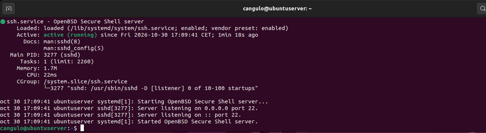
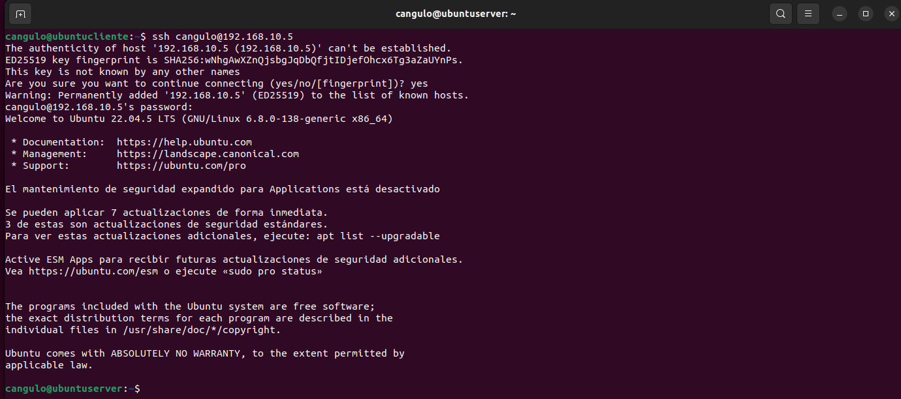
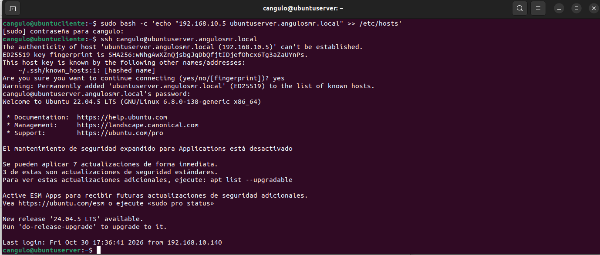
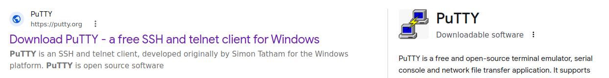
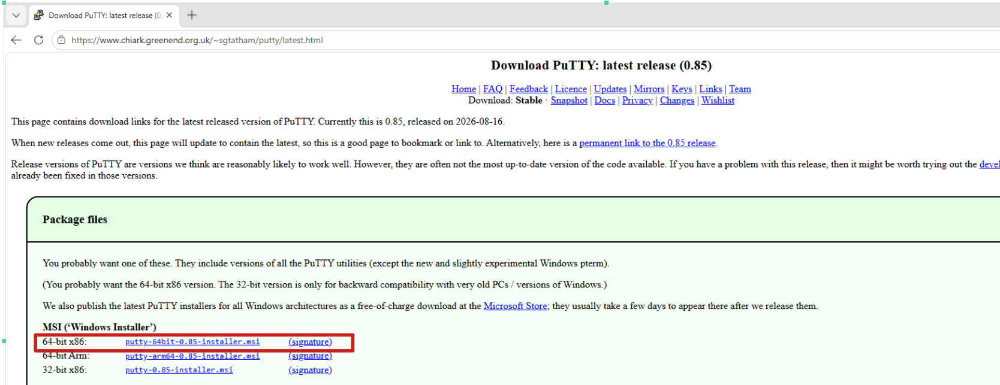
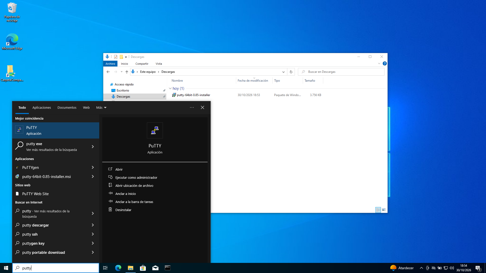
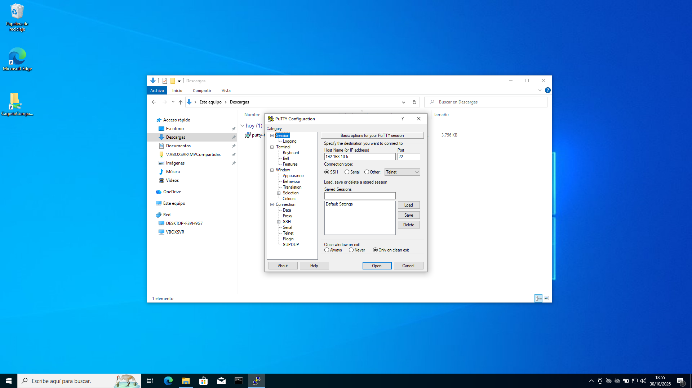
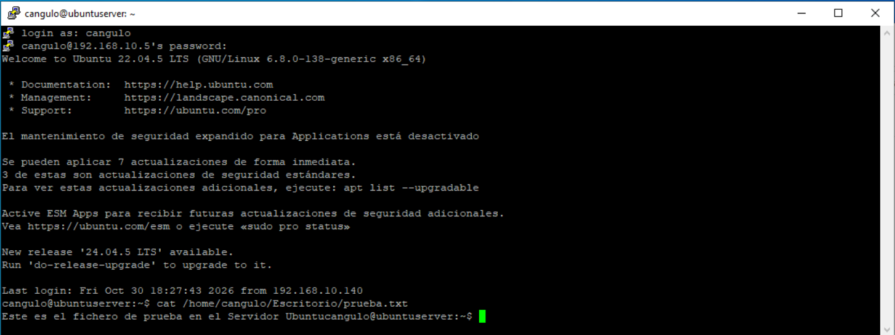

# Actividad 09. SSH en el Servidor Ubuntu #

Vamos a instalar el servicio SSH en el servidor Ubuntu para poder acceder a él desde los **clientes Windows y Ubuntu**. 

!!! warning "Servicio DNS activo"
    Para poder completar la actividad actual exitosamente deberás tener el servicio DNS del servidor Ubuntu operando adecuadamente

## <div style="background-color: #f5dcd6; color: black; width: 100%; padding: 0px 5px; margin: 0; box-sizing: border-box;">1. Configuración previa de los equipos</div> ##

Para poder realizar la actividad adecuadamente debemos configurar las máquinas virtuales para que tengan la información correspondientes:

- Configurar la red NAT como `192.168.10.0/24` y llamarla `RedNatServicios`
- Asignar a las máquinas virtuales la red Nat anterior.
- Asignar las siguientes configuraciones:

| Configuración     | Servidor Ubuntu   | Cliente Ubuntu | Cliente Windows |
| ------------------|-------------------|----------------|-----------------|
| IP                | 192.168.10.5      | 192.168.10.140 | 192.168.10.141  |
| IP servidor DNS   | 192.168.10.5      | 192.168.10.5   | 192.168.10.5    |

## <div style="background-color: #f5dcd6; color: black; width: 100%; padding: 0px 5px; margin: 0; box-sizing: border-box;">2. Instalar el paquete openssh en el servidor Ubuntu</div> ##

1.- En el servidor Ubuntu, ejecutar la siguiente instrucción:
```
sudo apt install openssh-server
```

2.- Una vez instalado vamos a comprobar que el servicio está activo. Para ello ejecutar:
```
 service ssh status
```



 3.- En el escritorio del servidor, crear un archivo de texto que llamarás `prueba.txt`:
 ```bash
 sudo joe /home/cangulo/Escritorio/prueba.txt
 ```

4.- Escribe dentro de él la frase: 
```bash
Este es un fichero de prueba en el servidor Ubuntu
```

!!! note "¿Para qué usaremos ese fichero?"
    El fichero prueba.txt lo usarás para aprender a acceder a los archivos del servidor desde el cliente.


## <div style="background-color: #f5dcd6; color: black; width: 100%; padding: 0px 5px; margin: 0; box-sizing: border-box;">3. Conexión remota por SSH desde cliente</div> ##

Ahora vamos a conectarnos al servidor desde el cliente ubuntu. 

1.- Abrimos el cliente y ejecutamos en la terminal la siguiente sentencia:
```
ssh cangulo@192.168.10.5
```

!!! warning "Indica tus parámetros"
    -  `cangulo` → este es el usuario de mi servidor Ubuntu. deberás sustituirlo por el tuyo.
    - `192.168.10.5` → esta es la **IP** de mi servidor Ubuntu. Debería ser la misma para el tuyo. En caso contrario sustituir también la IP por la de tu servidor Ubuntu.

2.- Indicamos al cliente SSH que **SI** queremos conectarnos al servidor Ubuntu.

3.- Indicamos la clave de acceso de nuestro usuario en el servidor Ubuntu.

Si el prompt de tu terminal a cambiado es porque te has conseguido conectar a tu servidore ubuntu. 




4.- Ejecuta el siguiente comando para comprobar que te devuelve la *IP** de tu servidor Ubuntu que debería ser `192.168.10.5`
```
ip a
```

!!! success "Captura de pantalla"
    Recuerda incluir en tu documento de trabajo una captura de pantalla con la ejecución del comando `ip a`.

5.- Ahora vamos a movernos por los directorios de nuestro servidor. Lo primero que haremos es acceder al **Escritorio**:
```bash
ls -l /home/cangulo/Escritorio
```

6.- Deberías poder ver el fichero `prueba.txt` dentro del directorio. Ejecuta la siguiente captura para comprobar su contenido:
```bash
cat /home/cangulo/Escritorio/prueba.txt
```

!!! success "Captura de pantalla"
    Recuerda incluir en tu documento de trabajo una captura de pantalla con la ejecución del comando anterior → `cat /home...` 

7.- Finalmente, desde el cliente Ubuntu, realiza una tarea de administración del servidor: añade el usuario
`alumno` al servidor con contraseña `Servicios2026`.
```bash
sudo useradd -m -s /bin/bash alumno && echo "alumno:Servicios2026" 
```

8.- Pon fin a la conexión escribiendo el siguiente comando en el cliente:
```bash
exit
```

9.- Comprueba que el usuario se ha creado con éxito. Abre el servidor Ubuntu y ejecuta el siguiente comando:
```bash
sudo cat /etc/passwd
```

!!! success "Captura de pantalla"
    Recuerda incluir en tu documento de trabajo una captura de pantalla en la que aparezca el listado de usuarios almacenados en el fichero passwd del servidor Ubuntu. Recuerda mostrar que estás viéndolo directamente desde el servidor.  


10.- Ahora que te has conectado a tu servidor Ubuntu, su clave pública está almacenada en `known_hosts`. Es el momento de consultar este archivo para comprobar la clave pública del servidor Ubuntu almacenada. Así pues, accede a la carpeta personal de tu usuario del cliente, y al directorio oculto .ssh
```bash
cat ~/.ssh/known_hosts
```

!!! note "Fichero known_hosts"
    El archivo "known_hosts" del cliente actúa como un registro de las claves públicas de los servidores a los que te has conectado. 

11.- Visualizar el contenido del archivo `known_hosts`. 

!!! success "Captura de pantalla"
    Recuerda incluir en tu documento de trabajo una captura de pantalla con la clave pública del servidor Ubuntu.


## <div style="background-color: #f5dcd6; color: black; width: 100%; padding: 0px 5px; margin: 0; box-sizing: border-box;">4. Conexión remota por SSH con el nombre de dominio</div> ##

!!! warning "¿Tienes activado el servicio DNS?"
    Recuerda que solo te funcionará si tienes el DNS bien configurado en tu servidor Ubuntu. Compruébalo haciendo, desde el cliente, una consulta nslookup tipo A al nombre de tu servidor.
    

!!! success "Captura de pantalla"
    Recuerda incluir en tu documento de trabajo una captura de pantalla con la consulta nslookup a tu servidor DNS.  

!!! warning "Antes de continuar"
    `ssh` utiliza el mecanismo estándar de Ubuntu gestionado por el archivo `/etc/nsswitch.conf` y el servicio `systemd-resolved`. Si este intermediario local tiene residuos de redes anteriores o no está bien sincronizado, bloqueará el nombre `.local`. 
    

1.- Para evitar el bloqueo de DNS ejectua desde tu cliente Ubuntu la siguiente sentencia:
```bash
sudo bash -c 'echo "192.168.10.5 ubuntuserver.angulosmr.local" >> /etc/hosts'
```

2.- En la consola del cliente, ejecutar el siguiente comando para conectar por SSH con el servidor nuevamente:
```bash
ssh cangulo@ubuntuserver.angulosmr.local
```



3.- Concluye los pasos para finalizar la conexión

!!! success "Captura de pantalla"
    Recuerda incluir en tu documento de trabajo una captura de pantalla con la conexión realizada utilizando el nombre de dominio del serivdor Ubuntu.  


4.- Cierra tu conexión SSH con el servidor desde el cliente y apaga la MV Cliente Ubuntu.


## <div style="background-color: #f5dcd6; color: black; width: 100%; padding: 0px 5px; margin: 0; box-sizing: border-box;">5. Acceder al servidor Ubuntu desde el cliente Windows</div> ##

Este apartado está pensado para conectar desde un entorno gráfico a nuestro servidor Ubuntu. Para ello abriremos el cliente Windows y seguiremos los siguientes pasos:

1.- Descarga putty de la página oficial de Putty: `putty.org` 






2.- Procede a la instalación de la aplicación y ábrela desde Windows:



3.- Configura una conexión Putty a tu servidor SSH. Debes incluir la IP y elegir el puerto que tenemos configurado por defecto: `puerto 22`




4.- Una vez conectado a tu servidor Ubuntu vuelve a mostar el contenido del fichero `pruebas.txt`
```bash
cat /home/cangulo/Escritorio/prueba.txt
```

!!! success "Captura de pantalla"
    Recuerda incluir en tu documento de trabajo una captura de pantalla con la conexión realizada y mostrando el contenido del fichero **pruebas.txt**




