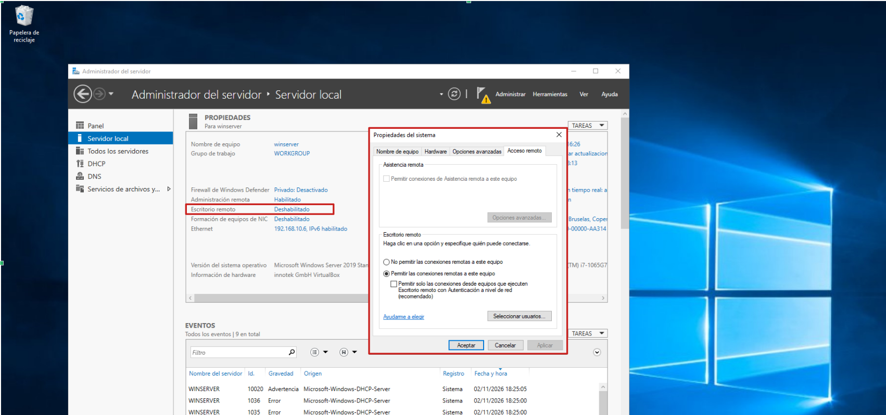
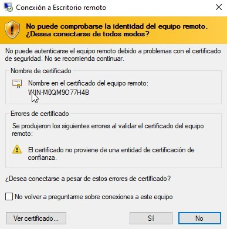
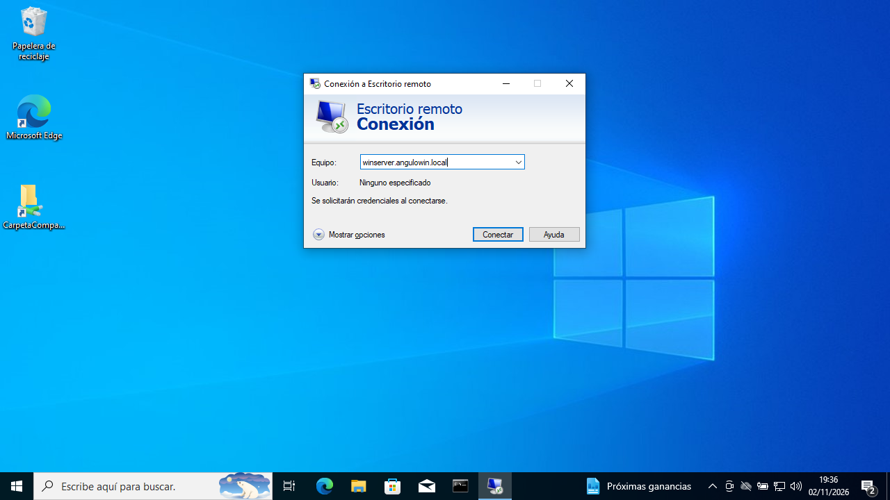
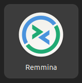
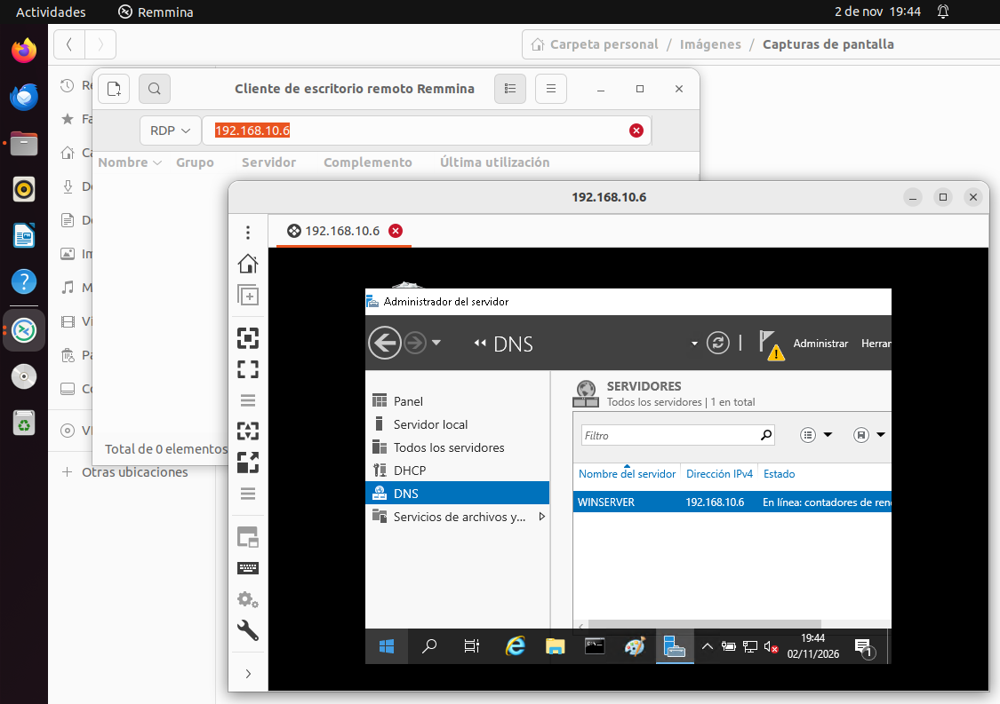

# Actividad 10. Escritorio remoto en Servidor Windows #

Vamos a configurar y utilizar el servicio de conexión por Escritorio Remoto a un servidor Windows. La conexión la realizaremos desde los **clientes Windows y Ubuntu**. 

!!! warning "Servicio DNS activo"
    Para poder completar la actividad actual exitosamente deberás tener el servicio DNS del servidor Ubuntu operando adecuadamente

## 
1. Configuración previa de los equipos
 ##

Para poder realizar la actividad adecuadamente debemos configurar las máquinas virtuales para que tengan la información correspondientes:

- Configurar la red NAT como `192.168.10.0/24` y llamarla `RedNatServicios`
- Asignar a las máquinas virtuales la red Nat anterior.
- Asignar las siguientes configuraciones:

| Configuración     | Servidor Windows   | Cliente Ubuntu | Cliente Windows |
| ------------------|-------------------|----------------|-----------------|
| IP                | 192.168.10.6      | 192.168.10.140 | 192.168.10.141  |
| IP servidor DNS   | 192.168.10.6      | 192.168.10.6   | 192.168.10.6    |

## 
2. Activar el escritorio remoto en el servidor Windows
 ##

1.- En el servidor Windows, en `administrador del servidor → servidor local`, habilitar el escritorio remoto.

!!! warning "Acceso remoto activado"
    - Por defecto la administración remota está habilitada. Comprobar que sea así.
    - Habilitar también la opción: `Escritorio remoto`

## 
3. Acceder al servidor Windows desde el cliente Windows con la IP
 ##

1.- En el cliente Windows, abrir la aplicación de escritorio remoto.

2.- Introducir la IP del servidor al que queremos acceder y, a continuación, el usuario y contraseña del servidor.

3.- Si es la primera conexión nos aparece una pestaña de este tipo. Aceptamos el certificado del servidor. Nos tiene que aparecer el escritorio del servidor.

!!! success "Capturas de pantalla"
    Entrega una captura de pantalla de la conexión al servidor desde el cliente (administrador del servidor visible)

4.- Desde el cliente Windows, realiza una tarea de administración del servidor : cambia su servidor DNS secundario al `1.1.1.1`. 

!!! success "Capturas de pantalla"
    Entrega una captura de pantalla con los cambios de DNS de servidor.

## 
4. Acceder al servidor Windows desde el cliente Windows con el nombre de dominio
 ##

!!! warning "¿Tienes activado el servicio DNS?"
    Recuerda que solo te funcionará si tienes el DNS bien configurado en tu servidor Windows. Compruébalo haciendo, desde el cliente, una consulta nslookup tipo A al nombre de tu servidor.

1.- La conexión deberás hacerla indicando: `Nombre del servidor + tu zona DNS`

    

!!! success "Capturas de pantalla"
    Entrega una captura de pantalla con la consulta nslookup

1.- En el cliente Windows, abrir la aplicación de escritorio remoto. En lugar de la IP introducir el nombre de dominio FQDN del servidor.

!!! success "Capturas de pantalla"
    Entrega una captura de pantalla de la conexión al servidor desde el cliente mostrando el servidor.
    
2.- Apaga el cliente Windows.

## 
5. Acceder al servidor Windows desde el cliente Ubuntu
 ##

1.- En el cliente Ubuntu, abrir el programa **Remmina** e introducir la IP del servidor Windows. Te pedirá confirmar que te fías del certificado del servidor. 

!!! note "Remmina"
    Remmina es un cliente de acceso remoto **RDP** que viene instalado por defecto en Ubuntu

2.- A continuación poner el usuario y contraseña del servidor Windows.

!!! success "Capturas de pantalla"
    Entrega una captura de pantalla de la conexión al servidor desde el cliente (administrador del servidor visible)

