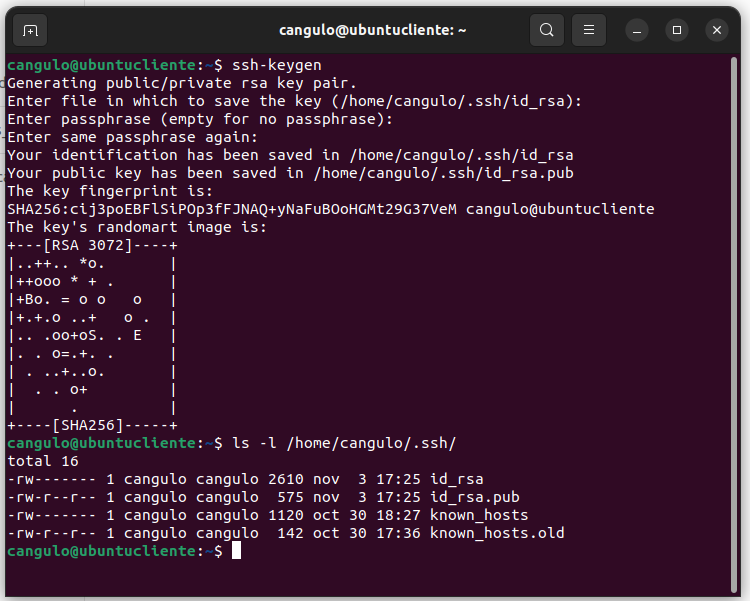
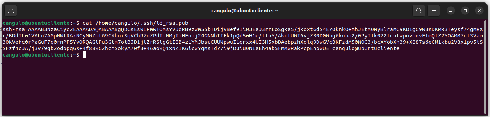
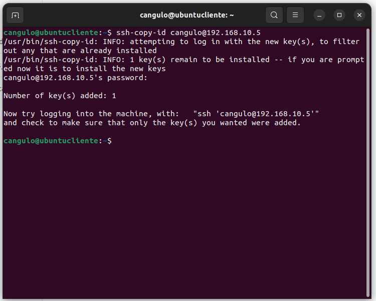
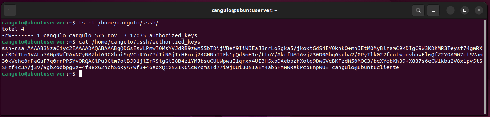
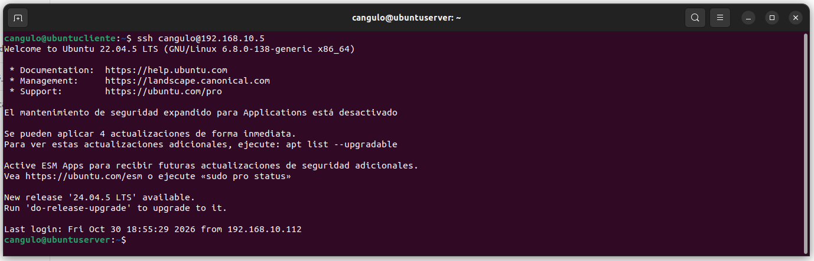
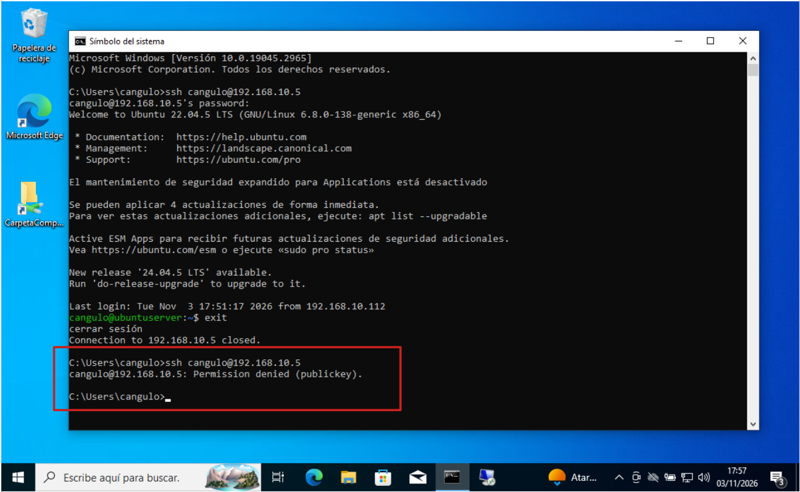

# Actividad 11. SSH con autenticación por claves #

Una forma alternativa al uso de usuario/contraseña para conectarnos por SSH es utilizar **criptografía asimétrica basada en claves**. Esta forma es mucho más segura ya que evitamos que las contraseñas puedan ser descubiertas si se utilizan contraseñas sencillas. Además permite no tener que introducir la contraseña cada vez que nos conectamos.

Además, vamos a configurar y utilizar el servicio de conexión por Escritorio Remoto a un servidor Ubuntu utilizando exclusivamente conexión con **clave pública  y clave privada**. La conexión la realizaremos desde los **clientes Windows y Ubuntu**. 

!!! warning "Servicio DNS activo"
    Para poder completar la actividad actual exitosamente deberás tener el servicio DNS del servidor Ubuntu operando adecuadamente


## <div style="background-color: #f5dcd6; color: black; width: 100%; padding: 0px 5px; margin: 0; box-sizing: border-box;">1. Configuración previa de los equipos</div> ##

Para poder realizar la actividad adecuadamente debemos configurar las máquinas virtuales para que tengan la información correspondientes:

- Configurar la red NAT como `192.168.10.0/24` y llamarla `RedNatServicios`
- Asignar a las máquinas virtuales la red Nat anterior.
- Asignar las siguientes configuraciones:

| Configuración     | Servidor Ubuntu   | Cliente Ubuntu | Cliente Windows |
| ------------------|-------------------|----------------|-----------------|
| IP                | 192.168.10.5      | 192.168.10.140 | 192.168.10.141  |
| IP servidor DNS   | 192.168.10.5      | 192.168.10.5   | 192.168.10.5    |


## <div style="background-color: #f5dcd6; color: black; width: 100%; padding: 0px 5px; margin: 0; box-sizing: border-box;">2. Conexión utilizando claves SSH privada y pública</div> ##

1.- Desde la máquina virtual del cliente Ubuntu vamos a generar el par de claves pública y privada. Desde la línea de comando ejecuta:
```bash
ssh-keygen
```

!!! note "Configuración de keygen"
    - Deja que las claves generadas se almacenen por defecto en la carpeta `/home/<usuario>/.ssh`
    - Para evitar tener que escribir siempre una clave, por defecto elige que **no** quieres elegir ninguna `passphrase`.

2.- Entra en la carpeta `/home/cangulo/.ssh` y comprueba que tienes un fichero llamado `id_rsa` con la clave privada y otro llamado `id_rsa.pub` con la clave pública.




3.- Ejecuta cat para comprobar el contenido del archivo en el que guardas tu **clave pública**:
```bash
cat /home/cangulo/.ssh/id_rsa.pub
```




!!! success "Capturas de pantalla"
    - Entrega una captura de pantalla con la creación del keygen
    - Entrega otra captura de pantalla con el contenido de tu clave pública.


4.- Ahora vamos a copiar la **clave pública** al servidor SSH para identificarte sin necesidad de usar contraseña. Para ello ejecuta la siguiente instrucción:
```bash
ssh-copy-id cangulo@192.168.10.5
```

!!! note "Parámetros de copia"
    - `cangulo` → nombre de tu usario en el servidor
    - `192.168.10.5` → **IP** de tu servidor Ubuntu
    - Cuando hagas la copia deberás indicar la contraseña de tu usuario Ubuntu




!!! note "El fichero authorized_keys"
    Desde este momento en el servidor Ubuntu existe una copia de la clave pública de nuestro cliente en un fichero llamado `authorized_keys`. Podrían haber más de una clave pública dependiendo de la cantidad de usuarios que se hayan conectado al servidor Ubuntu. 
    Si se quiere evitar que un usuario pueda conectar al servidor, basta con eliminar la linea correspondiente al usuario del fichero `authorized_keys`

5.- Realiza una consulta del fichero `authorized_keys` ubicado en la siguiente ubicación dentro del servidor Ubuntu.
```bash
/home/cangulo/.ssh/authorized_keys
```



!!! success "Capturas de pantalla"
    Realiza una captura de pantalla del contenido del fichero `authorized_keys` y conprueba que el contenido coincide con el del fichero `id_rsa.pub` de tu cliente.


6.- Es del momento de tratar de conectar de tu cliente ubuntu a tu servidor Ubuntu.
```bash
ssh cangulo@192.168.10.5
```

!!! success "Conexión directa"
    ¿Has tenido que indicar usuario y contraseña? ¿Por qué?


## <div style="background-color: #f5dcd6; color: black; width: 100%; padding: 0px 5px; margin: 0; box-sizing: border-box;">3. Forzando al servidor sólo conexiones con autenticación por claves</div> ##

1.- Accede a ese archivo `sshd_config` y fíjate en las lineas `PubkeyAuthentication` y `PasswordAuthentication`:
```bash
/etc/ssh/sshd_config
```

!!! success "Contesta a las preguntas"
    Por defecto, ¿está permitida la autenticación por claves? ¿Y por contraseña?

2.- Ahora vamos a forzar a que se use siempre la autenticación basada en claves. Para ellos modificamos el fichero `sshd_config` y actualizaremos los siguientes parámetros con los siguientes valores:
```bash
PubkeyAuthentication yes
PasswordAuthentication no

```

3.- Reinicia el servicio SSH.
```bash
sudo systemctl restart ssh
```

4.- Prueba a conectar desde tu cliente Ubuntu. Tienes que poder conectar sin que te pida clave.



5.- Prueba a conectar desde el terminal de tu cliente Windows. Verás que ya no te deja conectar. 



!!! success "Capturas de pantalla"
    - Entrega una captura de pantalla con la negación de la conexión con tu cliente Windows.
    - Entrega una captura de pantalla con la conexión desde tu cliente ubuntu sin necesidad de indicar password


