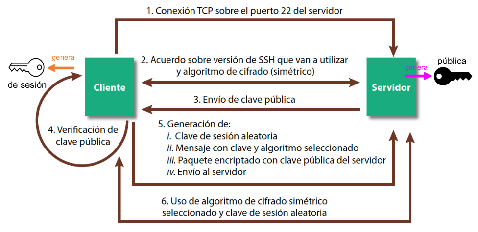
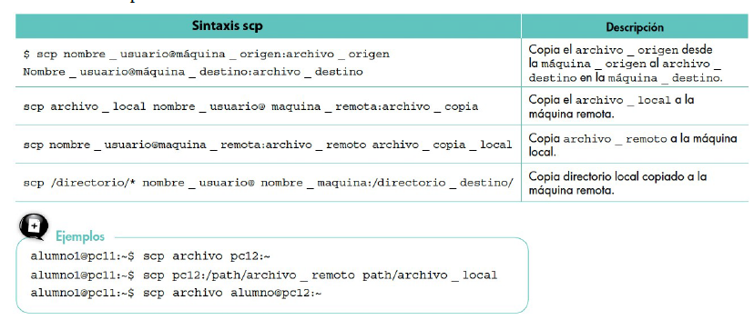

# Unidad 4. SSH. Acceso remoto #

## <div style="background-color: #f08408; color: black; width: 100%; padding: 0px 5px; margin: 0; box-sizing: border-box;">1. ¿Qué es el servicio de acceso remoto?</div> ##

Los servicios de acceso y control remotos permiten, mediante la utilización de determinado software, establecer conexiones con equipos a distancia y administrarlos de manera centralizada, sin necesidad de acceder a ellos.

Casos de uso:

- Equipo que no dispone de pantalla (servidores rack apilados…)
- Equipo que está lejos

Como vimos en la introducción existen herramientas de acceso remoto:

- En modo texto: SSH, Telnet…
- En modo gráfico: escritorio remoto de Windows, Team viewer…


!!! note "Un poco de Historia"
    En los años 1960-1970 la administración remota se hacía con la orden telnet. Se creó pensando en que fuera fácil de usar y no en la seguridad ya que en ese momento la seguridad en las redes no era un tema crítico. Actualmente no se debería utilizar telnet por los importantes agujeros de seguridad que presenta.


## <div style="background-color: #f08408; color: black; width: 100%; padding: 0px 5px; margin: 0; box-sizing: border-box;">2. Servicios de acceso remoto</div> ##

Existen muchos tipos de servicio de acceso remoto. En la actualidad, los servicios más utilizados son:

- **SSH** utilizado principalmente en entornos linux
- **RDP** utilizados principalmente en entornos Windows. A continuación vamos a exponer las principales características de ambos servicios de acceso remoto.

### 2.1. Servicio de acceso remoto SSH ###

El servicio de acceso remoto SSH **(Secure Shell)**, es principalmente un servicio utilizado en modo texto, es decir, a través del **terminal** y en entornos Linux (Ubuntu, lliurex, etc...).

Es un protocolo de la capa de aplicación que trabaja con el protocolo TCP de la capa de transporte a través del puerto **22**.

Funciona bajo una arquitectura **cliente - servidor** de modo que el cliente solicita una petición de acceso a un servidor (o máquina) y el servidor concede o no el acceso.

La autenticación se realiza mediante dos opciones:

- Usuario y contraseña.
- Genaración de clave. 

El estandar que describe el protocoloo de funcionamiento y características de SSH son: **RFC 4251, 4252 y 4253**

Los datos viajan cifrados y la versión actual es la SSH2, en la que se ha aumentado la seguridad.

!!! note "Ventajas del cifrado de la información"
    - Se evita la interceptación de la comunicación entre dos sistemas por parte de una máquina tercera.
    - Se minimiza el riesgo de suplantación de un host, es decir, es más difícil que una máquina finja ser la máquina de destino.

#### 2.1.1. Ventajas de SSH ####

- **Bajo Consumo de Ancho de Banda**: solo transmite texto, lo que lo hace eficiente en redes lentas o de baja calidad.
- **Seguridad Robusta**: utiliza cifrado fuerte y autenticación mediante claves, lo que lo hace seguro contra ataques.
- **Rápido para Administración de Sistemas**: Ideal para tareas de administración, configuración y monitoreo de servidores, especialmente en sistemas Linux y Unix.
- **Automatización**: permite la ejecución de scripts de forma remota, facilitando la gestión de múltiples servidores.
- **Compatibilidad Multiplataforma**: Funciona en casi todos los sistemas operativos y se integra bien en entornos mixtos.


#### 2.1.2. Inconvenientes de SSH ####

- **Sin Interfaz Gráfica**: No permite el uso de aplicaciones gráficas ni ofrece una visualización del escritorio, lo que limita su uso para aplicaciones de tipo GUI.
- **Curva de Aprendizaje**: Requiere conocimientos de comandos de línea de texto, lo que puede ser menos intuitivo para usuarios no técnicos.


### 2.2. Servicio de acceso remoto RDP ###

El servicio de acceso remoto RDP **(Remote Desktop Protocol)**, es principalmente un servicio utilizado en modo gráfico en entornos Windows.

Es un protocolo de la capa de aplicación que trabaja con el protocolo TCP de la capa de transporte a través del puerto **3389**.

Funciona bajo una arquitectura **cliente - servidor** de modo que el cliente solicita una petición de acceso a un servidor (o máquina) y el servidor concede o no el acceso.

La autenticación se realiza simplemente con usuario y contraseña y no existe un protocolo de estandarización al ser de código abierto.

Los datos viajan cifrados y la versión actual es la **RDP1 0.0**, en la que se ha aumentado la seguridad.

#### 2.1.1. Ventajas de RDP ####

- **Interfaz Gráfica Completa**: ofrece una experiencia de escritorio completa, adecuada para trabajar con aplicaciones gráficas y entornos interactivos.
- **Fácil de Usar para Usuarios**: Su interfaz gráfica es intuitiva, ideal para usuarios que no están familiarizados con la línea de comandos.

#### 2.1.2. Inconvenientes de SSH ####

- **Mayor Consumo de Ancho de Banda**: consume mucho más ancho de banda, afectando el rendimiento en redes lentas.
- **Menos eficiente para automatización**: no es adecuado para ejecutar scripts de forma remota.


## <div style="background-color: #f08408; color: black; width: 100%; padding: 0px 5px; margin: 0; box-sizing: border-box;">3. Arquitectura Servidor y Cliente acceso remoto</div> ##

El acceso remoto obedece a una arquitectura cliente-servidor donde el cliente realiza una petición de acceso a un servidor y el servidor concede el acceso servidor.

- **Servidor acceso remoto**: es una máquina que tiene instalado algún servicio de acceso remoto (el paquete open SSH de código abierto, el Escritorio remoto de Windows RDP o cualquier otro servicio).

- **Cliente acceso remoto**: una herramienta de software que permite al usuario, desde una máquina remota, solicitar acceso al servidor (cliente SSH de consola en Ubuntu, Putty en Windows o cualquier otra)

Para identificar al servidor al que queremos acceder se puede usar:

- La `IP` del servidor.
- El nombre de dominio `FQDN` si tiene uno registrado en un servidor DNS funcional

## <div style="background-color: #f08408; color: black; width: 100%; padding: 0px 5px; margin: 0; box-sizing: border-box;">4. Funcionamiento del servicio de acceso remoto SSH</div> ##

Por su versatilidad, felxibilidad, seguridad y uso, vamos a profundizar en el funcionamiento y uso del servicio SSH.

### 4.1. Canal cifrado SSH ###

El canal cifrado de SSH se basa en un sistema de claves. Una clave es un código que sirve para encriptar y desencriptar los textos transmitidos y recibidos.

- Las etapas 1 a 5 describen el intercambio inicial de claves. Es un proceso mediante el cual se establece una conexión segura antes de entrar al servidor.

- La etapa 6 es la sesión de acceso remoto vía SSH, es decir la etapa en la que hemos entrado al servidor y podemos trabajar como si estuviéramos delante de él.



!!! warning "Conexión SSH segura"
    Este esquema solo explica cómo se garantiza que la conexión SSH sea segura, no explica el proceso de autenticación.

1. La máquina cliente abre una conexión TCP sobre el puerto 22 del servidor.

2. La máquina cliente y el servidor se ponen de acuerdo sobre la versión de SSH que van a utilizar y sobre et tipo de algoritmo de cifrado para la sesión.

!!! note "Cifrado simétrico"
    Un algoritmo de cifrado simétrico implica que se usa la misma clave para encriptar y luego desencriptar.

3. El servidor envía su clave pública al cliente.

4. El cliente recibe la clave pública y verifica esta clave pública con su archivo known_hosts:

- Si la clave coincide, la conexión continúa
- Si no coincide o no está registrada, el cliente muestra un aviso para que el
usuario confirme si desea confiar en el servidor

5. El cliente genera una clave de sesión aleatoria y crea un mensaje que contiene la clave de sesión. Este mensaje es encriptado con la clave pública del servidor. El cliente envía ese mensaje al servidor. El servidor desencripta el mensaje y descubre la clave de sesión.

6. Empezamos el acceso remoto. El resto de los intercambios entre cliente y servidor se encripta y desencripta haciendo uso de la clave de sesión.

### 4.2. Proceso de autenticación ###

El proceso de autenticación se basa en uno de estos dos métodos.

- **Usuario y contraseña**:
    - Una vez establecido el canal cifrado, el cliente envía las credenciales (usuario y contraseña) al servidor.
    - El servidor valida estas credenciales en su base de datos y permite o niega el acceso.

- **Claves públicas/privadas generadas por el usuario**:
    - El usuario genera un par de claves públicas/privadas en el cliente.
    - La clave privada se guarda en el cliente mientras que la pública se comparte con el servidor.
    - En lugar de una contraseña, el cliente usa su clave privada para firmar un mensaje enviado por el servidor.
    - El servidor verifica la firma con la clave pública previamente registrada. Si coincide, se concede acceso.

### 4.3. Punto débil de SSH ###

En la etapa 4 hemos visto que, si se trata de la primera conexión a un servidor, el cliente aún no dispone de la clave pública del servidor y no puede realizar la comparación. En este envío un atacante podría sustituir la clave por otra y el cliente no se daría cuenta. De hecho, se trata de un tipo de ataque bastante común conocido como **man in the middle**. En las conexiones siguientes, el cliente será capaz de evaluar la autenticidad de la clave pública del servidor.

## <div style="background-color: #f08408; color: black; width: 100%; padding: 0px 5px; margin: 0; box-sizing: border-box;">5. Archivos de configuración SSH</div> ##

### 5.1. El archivo de configuración del Servidor SSH ###
```
/etc/ssh/sshd_config
```

Controla cómo se comporta tu máquina cuando actúa como servidor SSH y está esperando a que otros equipos (clientes) se conecten a ella.Algunos de los parámetros de configuración del fichero son:

`# port 22` : El puerto SSH.

`# ListenAddress 0.0.0.0` : Las redes por las que está escuchando el servidor SSH. En este caso escucha por todas las IPv4.

`# PermitRootLogin` : Restricciones sobre la conexión como usuario root.

`# MaxAuthTries 6` : Restricciones sobre el número máximo de intentos de autenticación.

`# MaxSession 10` : Restricciones sobre el número de sesiones simultáneas permitidas para un mismo usuario.

`# pubkeyAuthentication yes` : Permitir o no la autenticación por claves.

`# passwordAuthentication yes` : Permitir o no la autenticación por contraseña.


### 5.2. El archivo de configuración del cliente SSH ###
```
/etc/ssh/ssh_config
```
Este archivo controla cómo se comporta tu máquina Ubuntu cuando tú escribes el comando ssh usuario@servidor para conectarte a otro equipo externo. Podemos usar la misma configuración para todos los servidores **(hosts *)** a los que nos vamos a conectar o una configuración específica por servidor (host server10).
**(Host *)** indica que la configuración del cliente SSH vale para acceder a cualquier máquina remota.

### 5.3. El archivo de hosts conocidos de SSH ###
```
/home/cangulo/.ssh
```
!!! note "Carpetas ocultas"
    Recuerda que se usa el comando ls -a en lugar de ls para ver las carpetas ocultas.

Este fichero almacena las claves públicas de los servidores a los que se ha conectado el cliente.

!!! note "Copias seguras"
    - Con el comando `cp` se realizan copias sin cifrar.
    - Con el comando `scp` se realizan copias seguras de archivos, con conexión segura y encriptada, entre distintas máquinas.

    

