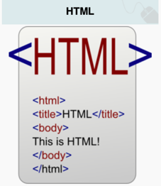
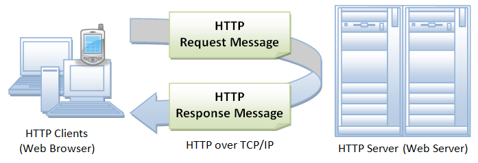
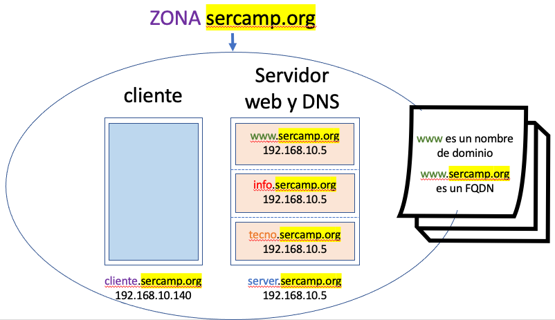
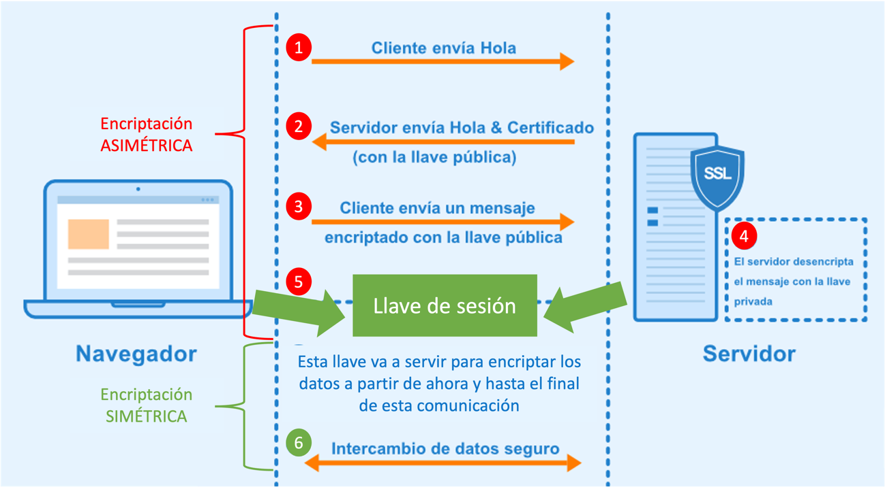

# Unidad 5. El Servicio Web #

## <div style="background-color: #d3ae08; color: black; width: 100%; padding: 0px 5px; margin: 0; box-sizing: border-box;">1. ¿Qué es el servicio web</div> ##

El servicio web HTTP es el sistema encargado de alojar, gestionar y entregar páginas web y recursos multimedia (como textos, imágenes, vídeos o archivos) desde un servidor hacia el navegador de un cliente a través de una red. 

!!! note "HTTP"
    - HTTP signfican **Hypertext Transfer Protocol** → `Protocolo de Transferencia de Hipertexto`. 
    - Es la base fundamental sobre la que funciona la World Wide Web (WWW).

### ¿Cómo funciona? ###

- **El Cliente**: Es el programa que inicia la comunicación. Cuando escribes una dirección URL, el cliente envía una petición HTTP (`HTTP Request`) al servidor solicitando ver un recurso concreto.

- **El Servidor Web**: Es el software instalado en la máquina servidora que permanece a la escucha. Recibe la petición, busca los archivos solicitados en su disco duro y los devuelve al cliente mediante una respuesta HTTP (`HTTP Response`).

!!! note "Cliente web"
    Normalmente es un **navegador web** (como Chrome, Firefox o Edge).

!!! note "Servidor web"
    Los más habituales son **Apache, Nginx o IIS**.

### ¿Qué es el Hipertexto? ###

Es el contenido de las páginas web que viene en formato **HTML**.

!!! note "HTML"
    HTML significa **HyperText Markup Language** → `Lenguaje de Marcas de Hipertexto`



### ¿Qué es el protocolo de transferencia? ###

Es el conjunto de reglas estándar de la capa de aplicación que permite el intercambio de información entre un navegador y un servidor web. Es el lenguaje común que utilizan los dispositivos para comunicarse en la World Wide Web.

!!! note "Información que se puede intercambiar"
    La información que se intercambia habitualmente a través del protocolo HTTP son `Páginas web, documentos, imágenes y datos`.

#### El intercambio de mensajes en texto plano ####

- **Conexión TCP**: Antes de enviar datos, el navegador establece una conexión fiable con el servidor utilizando el protocolo TCP (habitualmente en el puerto 80 para HTTP o 443 para HTTPS).

- **Petición HTTP (Request)**: El cliente envía un mensaje solicitando una acción concreta sobre un recurso (por ejemplo, descargar una página HTML).

- **Respuesta HTTP (Response)**: El servidor procesa la orden, localiza el archivo en su almacenamiento y devuelve un mensaje con el resultado y el contenido solicitado.


## <div style="background-color: #d3ae08; color: black; width: 100%; padding: 0px 5px; margin: 0; box-sizing: border-box;">2. Origen y Normativa</div> ##

HTTP fue creado en 1990 en el CERN. Originalmente fue diseñado como un medio para compartir los datos científicos a nivel internacional, rápidamente y a bajo coste. Hoy en día, es el método más común de intercambio de información en la World Wide Web La versión HTTP 1 fue estandarizada en 1996 mediante la RFC 1945. Desde entonces, HTTP ha ido evolucionando y la versión más reciente es HTTP 3, estandarizada en junio de 2022 en la RFC 9114. La mayoría de los navegadores ya soportan HTTP 3 pero solo el 25% de las páginas web usan esta nueva versión.

!!! note "CERN"
    CERN es el Laboratorio Europeo de Física de las Partículas.


## <div style="background-color: #d3ae08; color: black; width: 100%; padding: 0px 5px; margin: 0; box-sizing: border-box;">3. Arquitectura cliente/servidor de HTTP</div> ##

HTTP es un servicio basado en la arquitectura cliente-servidor y está basado en el envío de mensajes entre un cliente que quiere acceder a una página web y un servidor que le proporciona el acceso.

### El servidor web ###
Es un dispositivo que, haciendo uso del protocolo HTTP, atiende las peticiones de los clientes y les proporciona las páginas web solicitadas. 

!!! note "Servidores más utilizados"
    - Los dos servidores web más conocidos e importantes por sus niveles de implantación son:

    - Apache en entornos GNU/Linux
    - IIS (Internet Information Service) en entornos propietarios Windows.

### El cliente web ###
Suele ser el navegador de la máquina cliente, es decir una aplicación que permite visualizar páginas web alojadas en servidores web. Es capaz de interpretar código HTML mostrando el contenido de la página en la pantalla.




## <div style="background-color: #d3ae08; color: black; width: 100%; padding: 0px 5px; margin: 0; box-sizing: border-box;">4. La URL</div> ##

Una URL es la dirección única y estandarizada que identifica la ubicación exacta de un recurso en Internet, como una página web, una imagen o un archivo descargable. Actúa como la dirección postal que el navegador utiliza para encontrar y solicitar un elemento concreto a un servidor web.

Es la información que el usuario proporciona al cliente web para conectar con un servidor web.

!!! note "URL"
    URL significa **Uniform Resource Locator** → `Localizador Uniforme de Recursos`

### Componentes de una URL ###
Para entender cómo funciona en el módulo de Servicios en Red, observa las partes que componen esta dirección de ejemplo: http://angulosmr.com

- Protocolo o Esquema (`http://`) → Indica el conjunto de reglas que usará el navegador para comunicarse con el servidor. Los más comunes son **http://, https:// y ftp://**.

- Nombre de dominio o IP (`://angulosmr.com`): Identifica al servidor donde está alojado el recurso. El sistema DNS se encarga de traducir este nombre a su dirección IP correspondiente.

- Puerto (`:80`): Es la puerta lógica de entrada al servicio en el servidor. Suele omitirse porque los navegadores asumen el **puerto 80 para HTTP** y el **puerto 443 para HTTPS** de forma automática.

- Ruta o Path (`/practicas/index.html`): Señala la ubicación exacta de las carpetas y el archivo dentro del disco duro del servidor web.
- Parámetros o Query String (?tema=5): Son variables adicionales que se envían al servidor para filtrar información o ejecutar acciones dinámicas. Van precedidos por un signo de interrogación.


## <div style="background-color: #d3ae08; color: black; width: 100%; padding: 0px 5px; margin: 0; box-sizing: border-box;">5. Funcionamiento básico</div> ##

HTTP se basa en el envío de mensajes y su funcionamiento es el siguiente:

1.- El usuario especifica en el navegador la dirección de la página que quiere consultar. p.e.
```
https://www.claire.com/home/index.html
```

2.- El navegador decodifica la información de la URL diferenciando el protocolo de acceso, la IP o nombre de dominio del servidor, el puerto (opcional), la ruta al archivo, etc.

3.- El navegador establece una conexión con el servidor web y realiza una solicitud al servidor web, por ejemplo, **solicitud de página web**:
```
GET /index.html http/1.0
```

4.- El servidor envía dicha página (o si no existe, envía un código de error) y el navegador interpreta el código HTML recibido.
Ejemplo la página existe
```
HTTP/1.0 200 OK
```

5.- Se cierra la conexión.

### Tipo de operaciones que el cliente web puede solicitar al servidor web ###

| Tipo | Descripción                                                                                                                    |
|------|--------------------------------------------------------------------------------------------------------------------------------|
| GET | Obtiene información del servidor web. Esta es la operación que se ejecuta cada vez que el usuario pide acceso a una página web.
| POST | Envía información desde el navegador al servidor. Es la operación que se usa cuando el usuario introduce sus datos en un formulario web al realizar una compra o crear cuenta en una página |
| HEAD | Es similar a GET, pero solo se pide la cabecera de la página con información como el tamaño, tipo, fecha de modificación, etc. |

### Tipo de respuestas del servidor web ###

| Tipo | Descripción del tipo   | Ejemplo                              |
|------|------------------------|--------------------------------------|
| 1xx  | Mensaje informativo    |                                      |
| 2xx  | Mensaje de éxito       | 200 OK                               |
| 3xx  | Mensaje de redirección | 301 moved permanently                |
| 4xx  | Error del cliente      | 404 Not found                        |
| 5xx  | Error del servidor     | 500 internal server error            |


## <div style="background-color: #d3ae08; color: black; width: 100%; padding: 0px 5px; margin: 0; box-sizing: border-box;">6. Protocolo sin estado y cookies</div> ##

El protocolo HTTP es un protocolo sin estado, es decir, no recuerda nada relativo a conexiones anteriores a la actual. Pero las aplicaciones web necesitan frecuentemente mantener estado.

Para eso se usan las cookies, que es información que el servidor web almacena en el navegador del cliente. Esto permite a las aplicaciones web tener datos como preferencias del usuario, inicio de sesión, historial de navegación, etc y actuar en consecuencia.

!!! warning "Caché del navegador vs Cookies"
    - Hay que distinguir las cookies de la caché del navegador. Las dos cosas son mecanismos para almacenar información temporal en el lado del cliente, pero tienen propósitos distintos:
    - La caché almacena contenido de las páginas web para mejorar la velocidad de carga.
    - Las cookies almacenan información específica del usuario y de la sesión para mejorar la experiencia


## <div style="background-color: #d3ae08; color: black; width: 100%; padding: 0px 5px; margin: 0; box-sizing: border-box;">7. Alojar más de una página web en un único servidor</div> ##

Tanto Ubuntu como Windows permiten alojar más de una página web en un solo servidor. Supongamos que tenemos una página `www.sercamp.org` en una máquina de IP `192.168.10.5`. En ella queremos crear 2 páginas más de nombre `info.sercamp.org` y `tecno.sercamp.org`, en
la misma máquina de IP `192.168.10.5`. Todas responderán a una sola IP y atenderán peticiones por el puerto `80`.

Tanto en Ubuntu con Apache2 como en Windows con IIS lograremos añadir más páginas web al servidor usando sitios virtuales o virtualhosts.



!!! note "Subdominios"
    Cuando un servidor ajoja una sola página web es habitual nombrarla como `www`. Cuando hay más hay que buscar otros nombres para diferenciarlas como aquí con `info` y `tecno`:

A continuación mostramos la evolución jerárquica de cómo se construye una dirección web desde la unidad más pequeña (el nombre interno de un equipo o servicio) hasta la dirección completa que entiende un navegador:

1.- `info` → nombre del subdominio DN. Es el nombre corto o etiqueta individual que identifica a un servidor, servicio o subsección específica dentro de una red local o dominio.
2.- `info.sercamp.org` → nombre de dominio FQDN **fully qualified**. Es la identidad única y absoluta de ese equipo o servicio dentro de todo Internet. Se forma uniendo el nombre del host (info) con el dominio principal (sercamp.org).
3.- `http:// informática.sercamp.org` → URL. Es la dirección web completa lista para ser utilizada por una aplicación cliente (como un navegador web) para localizar y descargar un recurso.


## <div style="background-color: #d3ae08; color: black; width: 100%; padding: 0px 5px; margin: 0; box-sizing: border-box;">8. El servidor web seguro</div> ##

Una página web segura utiliza el protocolo **HTTPS** en lugar de utilizar el protocolo **HTTP**. HTTPS es idéntico al protocolo HTTP salvo que la información que pasa de cliente (navegador web) a servidor web viaja en Internet a través de un canal cifrado proporcionados por SSL o TLS.

Eso garantiza la confidencialidad de la información intercambiada entre el navegador y el servidor. Si durante la transferencia de la información un hacker hiciera una copia de los paquetes de datos e intentara descifrarlos, no podría hacerlo por fuerza bruta (probando todas las claves posibles) en un plazo mínimo de varios años.

Los navegadores llevan ya incorporados un módulo SSL TLS que se activa de forma automática cuando es necesario. La URL se escribe `https://` y aparece el candado cerrado.

## Funcionamiento de SSL y TLS ##

Los protocolos SSL (Secure Socket Layer) y TLS (Transport Layer Security) proporcionan los algoritmos de encriptación a la comunicación entre cliente y servidor. Cada dispositivo necesita un certificado SSL TLS con una clave pública y una clave privada.



1.- **Fase de saludo** → `[PASOS 1 a 5 del esquema]` Intercambio de clave de sesión - encriptación asimétrica (= se usa la clave pública del servidor para cifrar y la clave privada del servidor para descifrar) 


2.- **Intercambio de datos seguro**: `[Paso 6 del esquema]` Encriptación simétrica (=se usa la clave de sesión para cifrar Y descifrar).
PASO 6 del esquema.

!!! note "TLS"
    TLS es una versión más reciente y mejorada de SSL.


